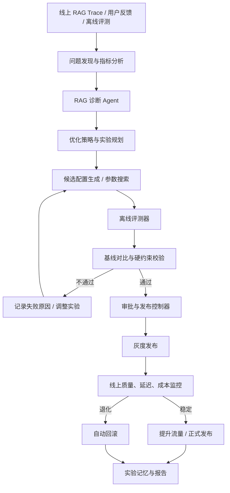
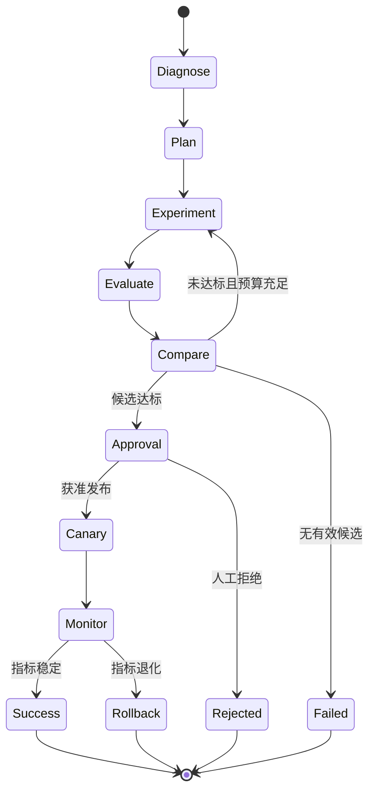

# RAG LLM 自动调优 Agent 设计方案

## 1. 目标与核心思路

RAG LLM 自动调优 Agent 的目标，是根据线上运行数据和离线评测结果，自动发现 RAG 链路中的问题，提出可验证的优化方案，通过实验筛选有效配置，并在满足安全条件后灰度发布。

核心闭环：

**发现问题 → 定位根因 → 生成优化方案 → 离线评测 → 对比基线 → 灰度验证 → 自动发布或回滚。**

不应让 LLM 任意修改线上 Prompt、检索代码或索引。推荐采用：

- LLM：负责分析问题、提出假设、生成结构化实验计划。
- 确定性代码：负责参数校验、评测、约束检查和结果比较。
- 参数搜索器：负责网格搜索、随机搜索或贝叶斯优化。
- 发布控制器：负责审批、灰度、监控和回滚。
- 状态机：负责任务持久化、重试、恢复和追踪。

## 2. 整体架构



架构上应区分两个系统：

- **RAG 业务执行系统**：负责正常处理用户问题。
- **RAG 优化系统**：负责分析数据、创建实验、评估候选配置和管理发布。

优化 Agent 通过配置管理与实验平台影响业务系统，不直接修改生产代码或绕过发布流程。

## 3. 可优化的 RAG 参数

| 阶段           | 可调参数                              | 主要评测指标                 | 备注                            |
| -------------- | ------------------------------------- | ---------------------------- | ------------------------------- |
| 文档解析与切片 | chunk size、overlap、结构化切分策略   | 证据覆盖率、Recall@K         | 部分改动需要重新索引            |
| 向量检索       | Embedding 模型、相似度阈值、Top-K     | Recall@K、Hit Rate、MRR      | 更换 Embedding 通常需要重建索引 |
| 混合检索       | BM25 权重、向量权重、RRF 参数         | Recall@K、NDCG               | 适合做参数搜索                  |
| 重排序         | Reranker 模型、候选数量、截断阈值     | NDCG、MRR、Context Precision | 需要评估额外延迟                |
| Query 改写     | Multi-Query、Query Rewrite、HyDE 开关 | Recall@K、延迟、Token 成本   | 增加模型调用可能提高成本        |
| 上下文组装     | 最大上下文长度、去重、证据截断        | Context Recall、Faithfulness | 关注噪声与证据丢失              |
| 生成           | System Prompt、模型、温度、输出长度   | 答案正确率、Faithfulness     | 应保留版本与回滚能力            |
| 系统运行       | 缓存、并发、超时、重试                | P95/P99 延迟、QPS、成本      | 注意不能牺牲正确性与可靠性      |

建议第一版只开放 3–5 个低风险参数，例如 Top-K、混合检索权重、Reranker 开关、上下文预算。切片策略和 Embedding 模型放在后续阶段，因为它们可能触发大规模重新索引。

## 4. 问题诊断机制

诊断应结合规则、Trace 和 LLM，而不是仅让模型阅读最终答案后猜测原因。

### 4.1 诊断流程

1. 检查标准答案所需证据是否进入 Top-K。
2. 若证据未召回，检查切片边界、Embedding、混合检索和 Query 改写。
3. 若证据已召回但排名较低，检查 RRF、Reranker 和候选数量。
4. 若证据召回正确但未进入最终上下文，检查过滤、去重、截断和上下文预算。
5. 若上下文证据充分但答案错误，检查 Prompt、模型行为、证据引用和输出约束。
6. 若质量正常但延迟或成本超标，检查检索耗时、生成耗时、缓存、重试与模型调用次数。

必须在评测集中保留标准答案对应的证据 chunk ID，才能区分“没有检索到”和“检索到了但模型没有正确使用”。

### 4.2 规则诊断示例

```python
def diagnose(metrics):
    issues = []

    if metrics["recall_at_5"] < 0.75:
        issues.append("RETRIEVAL_RECALL")

    if (
        metrics["recall_at_5"] >= 0.75
        and metrics["ndcg_at_5"] < 0.60
    ):
        issues.append("RANKING")

    if metrics["faithfulness"] < 0.80:
        issues.append("GENERATION_GROUNDING")

    if metrics["p95_latency_ms"] > 3000:
        issues.append("LATENCY")

    return issues or ["NO_CLEAR_ISSUE"]
```

上述阈值只是示例值，不是通用生产标准。实际阈值应根据业务基线、评测集分布和 SLA 制定。生产系统应允许多个问题同时存在，避免用单一互斥分类掩盖复合根因。

## 5. Agent 工具设计

推荐为优化 Agent 提供受控工具，而不是任意 SQL、Shell 或生产写权限。

| 工具                  | 职责                  | 默认权限     |
| --------------------- | --------------------- | ------------ |
| `analyze_failures`    | 分析失败样本和指标    | 只读         |
| `inspect_trace`       | 查看一次 RAG 执行链路 | 只读         |
| `get_rag_config`      | 获取当前配置版本      | 只读         |
| `create_experiment`   | 创建候选配置实验      | 可写实验区   |
| `run_offline_eval`    | 执行固定评测集        | 受预算限制   |
| `compare_experiments` | 对比基线和候选实验    | 只读         |
| `promote_candidate`   | 推进候选配置到灰度    | 审批后可执行 |
| `rollback_config`     | 恢复上一稳定版本      | 受控执行     |

核心原则：**Agent 负责提出决策，普通代码负责执行和校验。**

例如，LLM 可以建议将 Top-K 从 5 调整为 10，但参数校验器必须检查范围，实验平台负责运行评测，发布控制器负责判断是否可以上线。

## 6. 实验计划与参数搜索

### 6.1 输入给诊断 Agent 的结构化信息

```json
{
  "problem": "RETRIEVAL_RECALL",
  "baseline": {
    "top_k": 5,
    "embedding_model": "model_a",
    "hybrid_search": true,
    "reranker": true
  },
  "metrics": {
    "recall_at_5": 0.68,
    "ndcg_at_5": 0.72,
    "faithfulness": 0.91,
    "p95_latency_ms": 1800
  },
  "constraints": {
    "min_faithfulness": 0.88,
    "max_p95_latency_ms": 3000,
    "max_cost_increase_pct": 15
  }
}
```

### 6.2 输出的实验计划示例

```json
{
  "hypothesis": "关键证据未进入前五个检索结果",
  "experiments": [
    {
      "name": "topk_8",
      "changes": {
        "retrieval.top_k": 8
      },
      "reason": "增加候选证据数量",
      "expected_effect": "recall_at_k"
    },
    {
      "name": "topk_10",
      "changes": {
        "retrieval.top_k": 10
      },
      "reason": "验证更大的召回窗口",
      "expected_effect": "recall_at_k"
    }
  ]
}
```

真实实现中，实验计划还应包含预期副作用、评测指标、预算、停止条件和配置版本。可以使用模型支持的 Structured Output 或工具调用能力，但仍需服务端 Schema 校验。

### 6.3 搜索方法选择

| 方法                  | 适用场景               | 建议                 |
| --------------------- | ---------------------- | -------------------- |
| 网格搜索              | 参数少、候选范围明确   | MVP 首选             |
| 随机搜索              | 参数较多、组合空间较大 | 简单实用             |
| 贝叶斯优化            | 单次实验成本高         | 中后期采用           |
| 多臂老虎机            | 在线流量分配和持续试验 | 需要谨慎处理流量偏差 |
| LLM 提案 + 搜索器验证 | 根因复杂且需要业务解释 | 推荐组合             |

推荐流程：

**规则诊断 → LLM 提出假设 → 搜索器生成候选 → 确定性评测 → LLM 总结结果。**

LLM 不应自行决定实验是否成功，成功标准应由可复现的评测器和硬约束定义。

## 7. 状态机与可恢复执行



每个状态都应持久化，并至少记录：

- `optimization_run_id`：一次优化任务的唯一 ID。
- `baseline_version`：当前基线配置版本。
- `experiment_id`：实验 ID。
- `candidate_config`：候选参数快照。
- `evaluation_report`：评测报告。
- `approval_status`：审批状态。
- `deployment_status`：发布状态。

可以使用 LangGraph，也可以用自有状态机实现。关键能力是可恢复、可重试、可追踪，避免把所有逻辑塞进一个长循环。

## 8. 评测与候选选择

### 8.1 主要指标

| 维度       | 指标                                       | 用途                                 |
| ---------- | ------------------------------------------ | ------------------------------------ |
| 检索质量   | Recall@K、Hit Rate、MRR、NDCG              | 衡量相关证据是否召回以及排序是否合理 |
| 上下文质量 | Context Precision、Context Recall          | 衡量提供给模型的证据质量             |
| 生成质量   | 答案正确率、Faithfulness、Answer Relevance | 衡量答案是否正确、忠实且相关         |
| 系统性能   | P50/P95/P99、QPS、Token 成本               | 衡量性能和资源开销                   |

### 8.2 多目标优化

可构造一个示例效用函数：

\[
J = 0.4Q + 0.3R + 0.2F - 0.1C
\]

其中：

- \(Q\)：答案质量得分。
- \(R\)：检索质量得分。
- \(F\)：Faithfulness 得分。
- \(C\)：归一化成本与延迟惩罚。

权重仅用于示例，生产中应根据业务目标调整。安全、最低质量和 SLA 应设置为硬约束，而不只是效用函数中的惩罚项。

例如：

- Faithfulness 不得低于设定下限。
- P95 延迟不得超过 SLA。
- 单次回答成本增幅不得超过预算。
- 核心业务问题正确率不得出现显著退化。

只有满足硬约束的候选配置才进入最终排序。

### 8.3 基线对比示例

| 指标         |    基线 | 候选配置 | 解释           |
| ------------ | ------: | -------: | -------------- |
| Recall@K     |    0.68 |     0.82 | 召回提升       |
| Faithfulness |    0.91 |     0.90 | 略降，需要检查 |
| P95 延迟     |  1.8 秒 |   2.2 秒 | 仍需核对 SLA   |
| 单次成本     | 1.00 倍 |  1.12 倍 | 成本增加 12%   |

不能只因召回率提高就判定候选胜出。还应检查 Faithfulness 的下降是否超出统计波动、成本是否可接受，以及不同业务类别是否存在退化。

建议固定评测集版本、模型版本和评测规则；必要时采用配对 Bootstrap 等方法估计置信区间。LLM-as-a-Judge 可辅助评估答案质量，但应使用人工标注样本验证评审器的可靠性。

## 9. 数据模型建议

### `rag_configs`：配置版本表

保存配置 JSON、版本号、索引版本、创建人和版本差异。

### `rag_eval_cases`：评测集

保存问题、标准答案、相关证据 chunk ID、业务分类和数据版本。

### `rag_experiments`：实验表

保存基线版本、候选参数、优化假设、实验状态、预算和停止原因。

### `rag_eval_results`：评测结果表

保存指标、样本级结果、模型版本、运行耗时、Token 用量和失败原因。

### `rag_deployments`：发布记录表

保存候选版本、审批记录、灰度比例、线上监控和回滚版本。

存储建议：

- PostgreSQL：配置、任务状态、实验元数据和发布记录。
- ClickHouse：高频 Trace、样本级指标和性能明细。
- Qdrant 等向量库：继续服务于原有 RAG 业务。

工程细节：

- 配置使用不可变版本，避免覆盖历史配置。
- 同一实验的重试应具备幂等性。
- 每次评测绑定固定的评测集、代码和模型版本。
- Embedding 或切片策略变化时记录独立索引版本。
- 多租户系统按租户隔离评测数据、Trace 和实验权限。

## 10. 灰度发布、安全与回滚

发布控制器应独立于优化 Agent。推荐流程：

1. 离线评测通过。
2. 检查所有硬约束。
3. 根据风险决定是否人工审批。
4. 以小流量灰度发布。
5. 监控质量、延迟、错误率和成本。
6. 指标稳定则逐步提升流量。
7. 指标退化则自动回滚到上一稳定版本。

第一版建议采用人工审批；运行足够多的可靠实验后，再对低风险参数开放自动灰度。

不建议初期自动修改生产 Prompt、切片策略、Embedding 模型或权限策略。不同改动的影响范围不同，应进行风险分级。

## 11. 结合 aipack 的 MVP 落地计划

### 阶段一：可观测与基线评测（预计 2–3 天）

- 接入现有 RAG Trace。
- 建立 100–300 条带标准答案的评测样本作为起点。
- 计算 Recall@K、MRR、Faithfulness、P95 延迟和成本。
- 保存评测所用的配置版本和结果。

### 阶段二：诊断 Agent 与参数搜索（预计 3–5 天）

- 先覆盖 Top-K、混合检索权重、Reranker 开关和上下文预算。
- 实现结构化诊断和实验计划。
- 使用网格搜索生成候选配置。
- 在固定评测集上自动比较基线与候选方案。

### 阶段三：发布控制与实验闭环（预计 3–5 天）

- 增加配置版本管理和实验状态持久化。
- 增加审批、灰度、监控和回滚。
- 将实验结果写入 aipack 的运行追踪。
- 支持失败任务恢复和实验报告生成。

上述时间是初步估算，前提是已有可调用的 RAG 服务和基础 Trace 数据。

建议沿用已有的 TypeScript、Node.js、PostgreSQL、ClickHouse 和 LangGraph 技术栈；也可以使用 aipack 自有的工具注册、权限控制、状态持久化和 Trace 模块实现编排。

## 12. 面试表达示例

> 我设计了一套 RAG 自动调优 Agent，将 RAG 的检索、排序、上下文组装和生成拆成可观测的优化阶段。系统通过线上 Trace 和离线评测定位问题，再由诊断 Agent 生成结构化实验计划，通过参数搜索器创建候选配置，并在固定评测集上比较 Recall@K、Faithfulness、延迟和成本。通过硬约束、配置版本管理、灰度发布和自动回滚形成闭环。
>
> 在工程设计上，我没有让 LLM 直接修改生产环境，而是将 LLM 的决策能力与确定性评测、受控工具调用、持久化状态机和发布控制器分离，确保每次优化都可追踪、可复现、可回滚。

面试中应补充真实的实验结果，例如 Recall@5 提升幅度、P95 变化和单位请求成本变化。没有实际运行的数据时，应将其描述为设计方案或原型，不应把预期效果说成已实现的生产成果。

## 13. 实施优先级总结

第一版重点解决：

1. 检索召回不足。
2. 生成忠实度下降。
3. 评测结果可复现。
4. 实验状态可恢复。
5. 候选配置可安全回滚。

先开放 3–5 个可控参数，建立可靠的实验闭环，再扩展到 Embedding、切片策略和多模型路由。