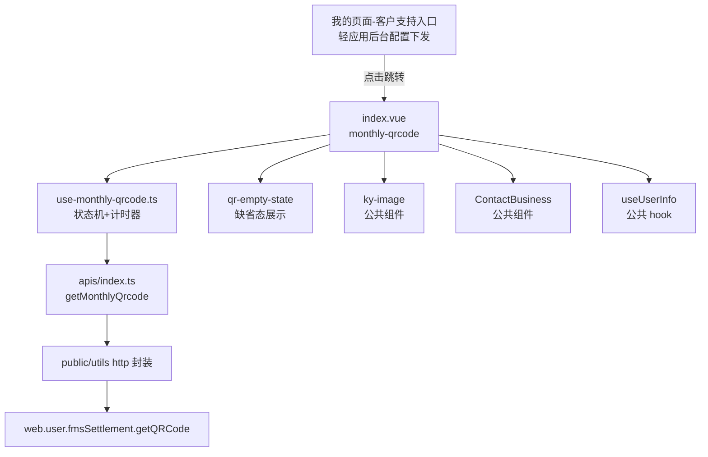
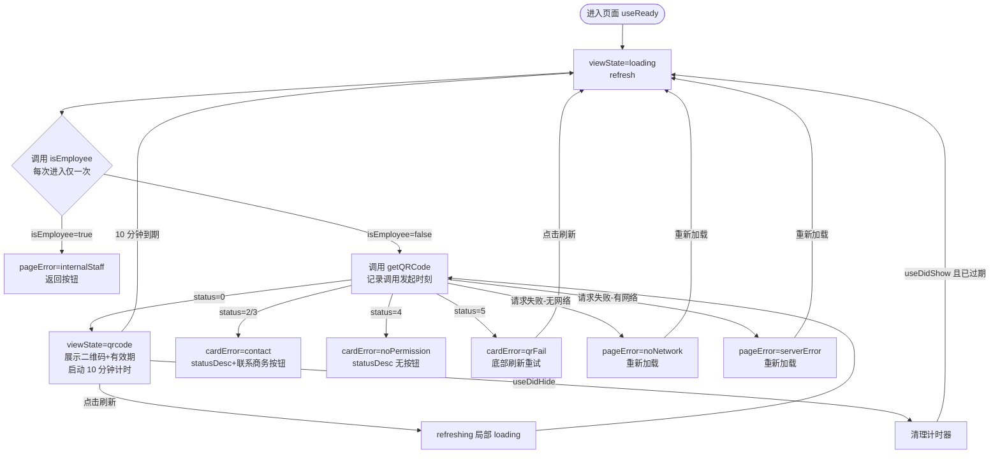

# 扫码转月结（月结二维码）技术设计

## Context

对应 proposal 能力 `monthly-qrcode-page`：互联网端新增月结二维码页面，月结客户出示二维码给司机扫码完成转月结确认。设计前提：月结码状态契约已确认为单接口 `web.user.fmsSettlement.getQRCode`，客户状态、月结方式、转月结权限的校验与优先级判定、异常文案（含脱敏主授权号）收敛到后端，前端不做权限判断；仅内部员工判定由前端单独调 `web.customer.isEmployee` 完成（见 `docs/adr/0001-monthly-qrcode-single-api-contract.md`）。入口由轻应用后台配置下发，不在本设计范围。

## Terminology

### 术语表

- **扫码转月结**：末端到付运单派送时，客户出示月结二维码、司机用取派端扫码，将到付单转为月结结算的确认动作。本端只负责出示码。
- **月结码 / 月结二维码**：客户出示给司机扫描的二维码，由财务系统生成，单次生成有效期 10 分钟，到期/手动刷新/重新进入页面均生成新码。
- **客户后台**：用户当前绑定的客户编码对应的后台账户，用户可切换绑定。
- **主授权号**：客户后台的公司主账号，唯一有权为本公司成员（按手机号）开通/关闭月结码生成权限的角色。无权限提示文案中展示其手机号，前三后四中间脱敏（如 159****1234），脱敏由后端完成。
- **转月结权限（月结码生成权限）**：主授权号为公司成员开通的、允许其生成月结码的权限。
- **内部员工**：跨越内部员工账号，不可使用该功能；进入页面时由前端调 `web.customer.isEmployee` 判定并整页拦截。
- **单接口契约**：页面的月结码状态只调用 `web.user.fmsSettlement.getQRCode`，页面状态由 `data.status` 枚举驱动的前后端约定（内部员工判定不在其内）。
- **有效期本地计时**：前端以接口调用发起时刻 + 10 分钟计算过期时刻并展示有效期区间的机制。

## Goals / Non-Goals

**Goals:**

- 交付月结二维码页面：内部员工前置拦截 + 按 `data.status` 枚举驱动加载中 / 正常 / 卡片内异常 / 整页异常全部状态。
- 交付二维码有效期本地计时、到期自动刷新、手动刷新、页面重新显示时过期即刷新的完整计时机制。
- 交付异常兜底：无网络 / 服务器异常整页缺省 + 重新加载，联系商务弹窗复用现有组件。

**Non-Goals:**

- 不做「我的页面 → 客户支持」入口的前端代码（入口由轻应用后台配置下发）。
- 不做取派端扫码端改造、不做月结账号开通与权限配置流程。
- 不做权限优先级前端判定（status 优先级由后端保证，前端按枚举直显）。

## Decisions

### 决策 1：单接口契约 + 内部员工单独拦截

- **决策内容**：页面月结码状态只调用 `web.user.fmsSettlement.getQRCode`（无入参），`data.status` 枚举（0 成功 / 2 客户状态异常 / 3 非月结 / 4 无权限 / 5 二维码获取失败）直接映射页面状态；异常文案直显后端 `statusDesc`。内部员工不在该枚举内：进入页面时前端单独调 `web.customer.isEmployee`（入参当前登录手机号），命中则整页缺省拦截、不再调用 `getQRCode`；身份校验每次进入页面只做一次，放行后的定时/手动刷新不再重复调用。
- **理由**：后端已将客户状态、月结方式、转月结权限的校验与优先级判定、脱敏文案收敛到单接口，前端再做判断会产生与后端口径不一致的双份逻辑；内部员工身份属用户属性而非客户后台属性，后端不提供在 getQRCode 契约内，复用公共 `isEmployee` 接口避免后端改动；状态机只有加载中 / 正常 / 内部员工 / 异常四种，不存在「校验通过但生成失败」的中间态组合。
- **备选方案**：PRD 原设计「权限校验接口 + 财务生成码接口」两段式调用。弃用依据：后端最终落地契约不再提供独立校验接口，两段式会引入双接口时序与中间态组合问题。

### 决策 2：有效期前端本地计时

- **决策内容**：以接口调用发起时刻 + 固定 10 分钟（常量 `VALID_DURATION = 10 * 60 * 1000`）计算过期时刻，展示区间格式 `YYYY-MM-DD HH:mm 至 YYYY-MM-DD HH:mm`；到期用 `setTimeout` 自动重新调接口；`useDidHide`/卸载时清理计时器，`useDidShow` 时若已过期立即重取。
- **理由**：单接口契约不返回码生成时间与有效时长字段，经与后端确认按调用发起时间 + 固定 10 分钟处理；刷新动作本身就是重新生成新码，本地时钟与后端实际过期时刻的秒级偏差不影响正确性。
- **备选方案**：后端补返生成时间/有效时长字段后以后端时间为准。弃用依据：当前契约无此字段；若日后补返，仅需替换有效期计算常量一处。

### 决策 3：状态管理 —— 页面级 Composition Hook，不引入全局 store

- **决策内容**：页面状态收敛在 `hooks/use-monthly-qrcode.ts` 的 `useMonthlyQrcode()` 中，以 `ref` 暴露 `viewState / qrCodeUrl / validityText / refreshing / cardErrorKind / pageErrorKind / errMsg / refresh / clearTimer`；不注册 Pinia/Vuex 模块。
- **理由**：状态无跨页面共享需求，单页面消费；hook 内聚计时器与请求逻辑，页面组件只做视图映射。
- **备选方案**：注册全局 store 模块。弃用依据：无跨页面状态消费者，引入 store 增加模板代码与心智成本。

### 决策 4：路由 —— 独立分包 `monthly-settlement`

- **决策内容**：新增分包 `modules/monthly-settlement`，页面路径 `pages/monthly-qrcode/index`，在 `src/wx.config.ts`、`src/alipay.config.ts` 的 subPackages 中注册；页面无路由参数、无路由守卫；`index.config.ts` 关闭下拉刷新，导航标题「扫码转月结」。
- **理由**：功能独立、非首屏路径，独立分包避免主包体积增长；权限校验由接口状态承担，无需前端路由守卫。
- **备选方案**：挂入既有分包。弃用依据：既有分包与月结业务无关，混入会破坏分包内聚。

### 决策 5：组件选型 —— 复用现有公共组件

- **决策内容**：加载态用 `ky-loading`；二维码图片用公共 `ky-image`（`@/public/components/base/ky-image/index.vue`）；缺省态用页面内 `components/qr-empty-state`（图标 + 文案 + 可选按钮的纯展示组件）；联系商务复用公共 `ContactBusiness`（`@/public/components/business/contact-business/index.vue`），手机号取 `useUserInfo()` 的 `userInfo.phone`。
- **理由**：kye-miniui 与项目公共组件已覆盖全部 UI 需求，无新增组件库的必要；`qr-empty-state` 因布局为本页定制（卡片内与整页两种形态）故放页面目录，不沉淀为公共组件。
- **备选方案**：无其他可行方案。

### 决策 6：数据获取 —— 统一 `refresh()` 入口

- **决策内容**：首次进入（`useReady`）、手动刷新、整页缺省「重新加载」、到期自动刷新统一走 `refresh()`；接口调用 `hideToast: true`，错误提示全部由页面状态机接管。
- **理由**：四个触发点的请求与状态流转完全一致，统一入口消除分支差异；全局 toast 与页面缺省态并存会双重提示。
- **备选方案**：各触发点独立调用。弃用依据：四处逻辑重复，计时器重置与 loading 切换易漏。

### 决策 7：表单校验 —— 不涉及

- **决策内容**：页面无任何表单与输入控件，不涉及表单校验。
- **理由**：页面只读展示二维码与文案，唯一输入是刷新/返回/联系商务三个按钮动作。
- **备选方案**：无其他可行方案。

## Risks / Trade-offs

- **本地计时 vs 后端权威时间（决策 2）**：有效期展示与自动刷新依赖用户设备本地时钟，设备时间不准时展示区间与后端实际过期时刻存在偏差；接受理由：刷新即重新生成新码，偏差仅影响展示文案，不影响扫码结果。后端日后补返时间字段时需替换 `VALID_DURATION` 计算点。
- **单接口直显 statusDesc（决策 1）**：文案完全依赖后端返回，后端文案变更无需发版即可生效（灵活性），代价是前端无法对文案做本地化与长度兜底；`statusDesc` 缺失时按 `status` 使用前端 fallback 文案（如「二维码生成失败，请重新加载」）。
- **`status` 兼容字符串类型（Data Model）**：`status` 声明为 `number | string`，比较前统一转数值，代价是多一层归一化判断，换取对后端序列化差异的容错。

## Architecture

### 目录结构

```
src/modules/monthly-settlement/
└── pages/
    └── monthly-qrcode/
        ├── index.vue                  # 页面组件：视图状态映射、联系商务弹窗
        ├── index.config.ts            # 页面配置：标题/背景色/关闭下拉刷新
        ├── index.scss                 # 页面样式
        ├── apis/
        │   ├── index.ts               # getMonthlyQrcode() 接口封装
        │   └── types.ts               # MonthlyQrcodeStatus 枚举、MonthlyQrcodeData
        ├── components/
        │   └── qr-empty-state/
        │       └── index.vue          # 缺省态展示组件（图标+文案+可选按钮）
        ├── constants/
        │   └── images.ts              # 页面图片资源常量
        └── hooks/
            └── use-monthly-qrcode.ts  # 状态机、计时器、请求逻辑
```

分包注册：`src/wx.config.ts`、`src/alipay.config.ts` subPackages 增加 `{ root: 'modules/monthly-settlement', pages: ['pages/monthly-qrcode/index'] }`。

### 框架层级关系



### 核心业务流程



### 路由规划

- 新路由：`/modules/monthly-settlement/pages/monthly-qrcode/index`（分包内相对路径 `pages/monthly-qrcode/index`）。
- 路由参数：无。守卫：无（权限由接口状态承担）。
- 页面不使用通用查询配置（genericCode），无对应编码。

### 数据流向

- 父 → 子 props：`index.vue` → `qr-empty-state` 传 `icon / title / desc / buttonText`；`index.vue` → `ContactBusiness` 传 `v-model:show`、`phone`。
- 子 → 父 emit：`qr-empty-state` 触发 `@action`，由 `index.vue` 的 `onCardErrorAction` / `onPageErrorAction` 分发（打开联系商务弹窗 / 返回 / 重新加载）。
- 全局 store / EventBus：不使用。页面状态由 `useMonthlyQrcode()` 的 `ref` 直接绑定模板。

## Data Model

不使用 Vuex/Pinia；不涉及表单与校验规则；不使用数据字典 lookupCode 与通用查询配置（接口枚举由后端接口返回，非数据字典）。

### 实体：MonthlyQrcodeData（接口响应 data）

| 字段 | 类型 | 必填 | 默认值 | 说明 | 示例 |
| --- | --- | --- | --- | --- | --- |
| status | number \| string | 是 | 无 | 状态码：0=成功，2=客户状态异常，3=非月结客户，4=无权限，5=二维码获取失败；兼容字符串序列化，比较前归一化为数值；内部员工不在此枚举（由 isEmployee 前置拦截） | 0 |
| qrCodeUrl | string | status=0 时必填 | 无 | 二维码图片地址 | `https://oss.example.com/qr/xxx.png` |
| statusDesc | string | status≠0 时必填 | 无 | 异常提示文案，后端已拼好脱敏主授权号等完整内容 | `该客户编码无转月结权限，您可联系主授权号（159****1234）开通` |

### 枚举：MonthlyQrcodeStatus（`apis/types.ts`）

| 枚举值 | 名称 | 页面映射 |
| --- | --- | --- |
| 0 | Success | viewState=qrcode |
| 2 | CustomerAbnormal | viewState=cardError, cardErrorKind=contact |
| 3 | NotMonthlySettlement | viewState=cardError, cardErrorKind=contact |
| 4 | NoPermission | viewState=cardError, cardErrorKind=noPermission |
| 5 | QrcodeFail | viewState=cardError, cardErrorKind=qrFail |

### 页面状态实体（hook 内 ref）

| 字段 | 类型 | 默认值 | 说明 |
| --- | --- | --- | --- |
| viewState | `'loading' \| 'qrcode' \| 'cardError' \| 'pageError'` | `'loading'` | 页面顶层状态 |
| qrCodeUrl | string | `''` | 二维码图片地址 |
| validityText | string | `''` | 有效期区间文案 |
| refreshing | boolean | `false` | 正常态下二维码区域局部 loading |
| cardErrorKind | `'contact' \| 'noPermission' \| 'qrFail'` | `'qrFail'` | 卡片内缺省类型 |
| pageErrorKind | `'internalStaff' \| 'noNetwork' \| 'serverError'` | `'serverError'` | 整页缺省类型 |
| errMsg | string | `''` | 后端返回的异常文案（取自 `data.statusDesc`） |

## API Design

| 方法 | 接口 | 描述 |
| --- | --- | --- |
| POST | `web.user.fmsSettlement.getQRCode` | 获取月结二维码及状态（客户状态/月结方式/转月结权限校验由后端在接口内完成） |
| POST | `web.customer.isEmployee` | 是否内部员工（进入页面时调用一次，命中整页拦截，不再调 getQRCode） |

### 请求参数

无入参。用户身份（手机号、当前绑定客户编码）由登录态与后端上下文获取。

### 响应结构

| 字段 | 类型 | 说明 |
| --- | --- | --- |
| code | number | 网关层响应码，0=成功 |
| msg | string | 网关层消息 |
| data.status | number \| string | 业务状态码，见 Data Model 枚举表 |
| data.qrCodeUrl | string | status=0 时返回，二维码图片地址 |
| data.statusDesc | string | status≠0 时返回，完整异常文案 |

### 调用时机、Loading 与错误处理

| 调用时机 | Loading 处理 | 错误处理策略 |
| --- | --- | --- |
| 首次进入页面（useReady） | 整页 `ky-loading` | 无网络 → 整页缺省「网络错误，请检查网络后重新加载」；有网络请求失败 → 整页缺省「服务器开小差了，请重新加载」；均提供「重新加载」按钮重新调用 |
| 点击底部「刷新」（正常态） | 二维码区域局部 loading，有效期文案保留 | 同首次进入；业务态 status≠0 按枚举切卡片内缺省 |
| 10 分钟到期自动刷新 | 二维码区域局部 loading，无提示 | 同首次进入 |
| 整页缺省「重新加载」 | 先切回整页 loading | 同首次进入 |
| 页面 useDidShow 且已过期 | 整页 loading | 同首次进入 |

接口调用统一 `hideToast: true`，不使用全局 toast 提示，错误反馈全部由页面缺省态承担。

## User Interface Design

### 页面布局

移动端单栏布局（设计稿宽度 750rpx 基准，rpx 自适应各端宽度，无响应式断点）：

1. 顶部装饰区：背景图 + 遮罩 + 月结主题头图（`BG_HEADER_IMG`、`HEADER_MONTHLY_IMG`）。
2. 二维码卡片（页面视觉中心，圆角白卡）：
   - 正常态：标题「请提供给跨越司机」→ 二维码图片（`ky-image`，aspectFit）→ 「二维码有效期」标签 + 有效期区间值。
   - 卡片内缺省态：`qr-empty-state`（图标 + 异常文案 + 可选「联系商务」按钮）。
3. 底部刷新栏：`position: fixed` 钉在视口底部最上层，圆形刷新图标 + 「刷新」文字。
4. 整页态（覆盖以上布局）：整页 loading 或整页 `qr-empty-state`。
5. 弹层：联系商务弹窗 `ContactBusiness`，`v-model:show` 控制。

### 交互行为（触发条件 → 结果）

| 交互 | 触发条件 | 结果 |
| --- | --- | --- |
| 进入页面 | useReady | 整页 loading → 调接口 → 按 status 进入对应状态 |
| 点击底部「刷新」 | 任意非 loading 状态点击 | 正常态 → 二维码区域局部 loading 后重取；异常态 → 先回整页 loading 再重取 |
| 点击「联系商务」 | cardErrorKind=contact 时点击缺省按钮 | 打开 ContactBusiness 弹窗（传入当前用户手机号） |
| 点击「返回」 | pageErrorKind=internalStaff 时点击按钮 | `Taro.navigateBack()` 退出页面 |
| 点击「重新加载」 | pageErrorKind=noNetwork/serverError 时点击按钮 | 回整页 loading 并重新调接口 |
| 10 分钟计时到期 | 本地计时到达过期时刻 | 无提示自动重取，成功后更新二维码与有效期 |
| 页面重新显示 | useDidShow 且已过期 | 立即重取 |

### Loading / Empty / Error 三态

- **Loading**：首次进入与异常态重试为整页 `ky-loading`（文案「加载中」）；正常态刷新为二维码区域局部 loading 遮罩。
- **Empty**：本页面无空数据概念，二维码缺失一律按 Error 缺省处理。
- **Error**：分两级——卡片内缺省（status 2/3/4/5，页面框架与底部刷新栏保留）与整页缺省（内部员工/无网络/服务器异常，整页替换）。

### 表单提交反馈

不涉及表单提交，无提交成功/失败文案与弹窗关闭逻辑。

### 列表

不涉及列表，无分页、排序、列宽策略。

### 关键交互链路

1. 用户点击底部「刷新」→ `onRefresh()` 判断 `viewState`（非 qrcode 先置 loading）→ `refresh()` → `fetchQrcode()` 记录发起时刻并调接口 → 返回 `status=0` → 更新 `qrCodeUrl` / `validityText` / `viewState='qrcode'` → `scheduleRefresh(10min)` 重置计时器。
2. 计时器到期 → `fetchQrcode()` → 返回 `status=2` → `showCardError('contact', statusDesc)` → 卡片内缺省展示后端文案 + 「联系商务」按钮 → 用户点击按钮 → `qr-empty-state` emit `action` → `onCardErrorAction()` → `showContact=true` → ContactBusiness 弹窗打开。
3. 接口请求失败 → `isNoNetwork()` 判断网络类型 → 无网络 `showPageError('noNetwork')` / 有网络 `showPageError('serverError')` → 用户点击「重新加载」→ `onPageErrorAction()` → `viewState='loading'` → `refresh()`。

## Security & Performance

### 安全

- 敏感字段脱敏：主授权号手机号脱敏（前三后四）由后端在 `statusDesc` 中完成，前端只直显，不接触明文。
- 前端加密：不涉及（无敏感入参，接口无入参）。
- 权限控制粒度：页面级权限由接口 `status` 承担（后端按登录态与客户后台上下文判定），内部员工由前端调 `isEmployee` 前置拦截，无前端菜单 ID 与路由守卫；按钮级权限不涉及（页面无 authCode 管控按钮，联系商务/刷新按钮对全部可见用户开放）。
- 入口显示权限由轻应用后台配置控制，不在前端代码内。

### 性能

- 分包懒加载：页面注册在独立分包 `monthly-settlement`，不占用主包体积，按需下载。
- 图片资源：装饰图与缺省图标为分包内静态资源，二维码图片为接口返回的远程 URL，由 `ky-image` 按需加载。
- 计时器管理：`useDidHide` 与组件卸载时清理 `setTimeout`，避免后台计时与泄漏；重新显示时按过期判断决定是否立即重取，避免无效请求。
- 缓存策略：不缓存二维码（每次生成均为新码，缓存无意义且存在出示过期码风险）。
- 分页：不涉及。

## Module Dependencies

### 受影响的模块

| 模块 | 影响范围 | 应对方式 |
| --- | --- | --- |
| `src/wx.config.ts` | subPackages 新增 `monthly-settlement` 分包注册 | 仅追加配置项，不改动既有分包 |
| `src/alipay.config.ts` | 同上（支付宝端分包注册） | 仅追加配置项，不改动既有分包 |
| 我的页面（客户支持区域） | 无代码影响 | 入口由轻应用后台配置下发 |

### 依赖的工具/组件

| 依赖 | 用途 | 来源/版本 |
| --- | --- | --- |
| `ky-image` | 二维码图片展示 | `@/public/components/base/ky-image/index.vue`（项目公共组件） |
| `ky-loading` | 加载态 | kye-miniui 组件库（项目既有版本） |
| `ContactBusiness` | 联系商务弹窗 | `@/public/components/business/contact-business/index.vue`（项目公共组件） |
| `useUserInfo` | 获取当前用户手机号传入联系商务弹窗 | `@/public/hooks`（项目公共 hook） |
| http 封装 | 接口调用（`hideToast` 选项） | `@public/utils`（项目既有封装，基于 axios ^1.7.8 / taro-axios ^1.1.1） |
| `@tarojs/taro` | 页面生命周期（useReady/useDidShow/useDidHide）、`Taro.getNetworkType`、`Taro.navigateBack` | 4.1.2 |
| `vue` | ref/computed/onUnmounted | ^3.5.13 |

不新增任何第三方依赖包。

### 依赖的后端服务

| 接口 | 入参 | 出参 |
| --- | --- | --- |
| `web.user.fmsSettlement.getQRCode` | 无 | `status`（number\|string）、`qrCodeUrl`（status=0）、`statusDesc`（status≠0，含脱敏主授权号文案） |

## Compatibility

- 新旧数据兼容：不涉及。页面为全新页面，无历史数据与历史版本页面，不存在字段缺失场景。
- 接口版本兼容：`status` 声明为 `number | string`，比较前归一化为数值，兼容后端数字/字符串两种序列化；若后端日后新增 status 枚举值，前端按未知状态走 `qrFail` 兜底缺省，不白屏。
- 路由兼容：不涉及。本次为新增路由，无旧 URL 变更与重定向需求。

## Deliverables

本次无公共产出。`qr-empty-state` 缺省组件与 `useMonthlyQrcode` hook 的布局与状态机为本页定制，暂无第二个使用场景，保留在页面目录 `src/modules/monthly-settlement/pages/monthly-qrcode/` 下，不做公共沉淀；若后续出现同类单接口状态机页面，再评估抽离。
