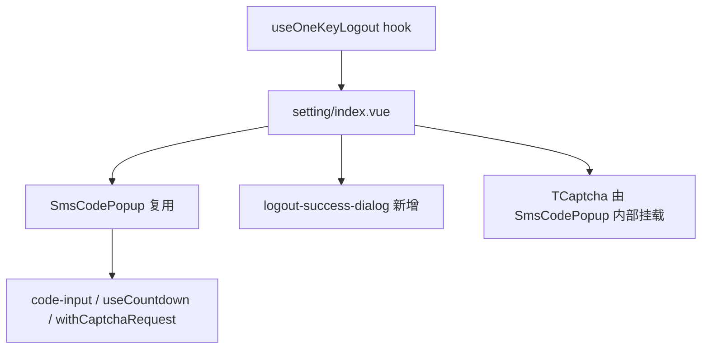
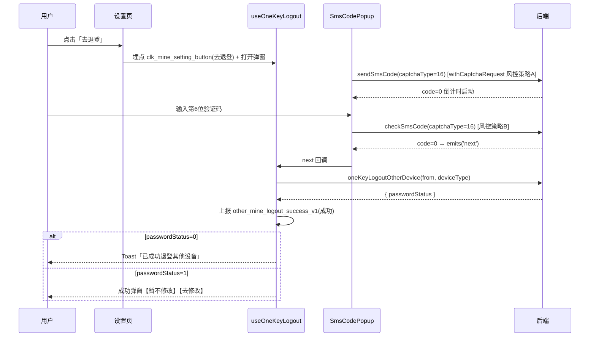

# Design: 设置页一键退登其他设备

---

## Context

跨越寄件小程序设置页与 APP 账户与安全页需新增「一键退登其他设备」能力：用户短信验证码二次确认后，保留当前设备、退出该手机号在其他设备的登录态。对应 proposal 中的能力：`one-key-logout-entry`、`logout-success-feedback`。两个入口同属本项目：小程序设置页为 `src/modules/setting/pages/index/index.vue`（微信/支付宝/高德/飞书共用）；APP 端以微信多端 App 壳形态运行，`index.vue` 经 `isWeixinAppSync()` 切换到 `index.app.vue`，其「账户与安全」条目进入 `src/modules/setting/pages/account/index.vue`（手机号/登录密码/号码保护，与 APP 设计稿结构一致）。后端 web-user-sso 已定接口设计（`captchaType=16`、新增退登接口、出参 `passwordStatus`），风控走 web-uam `@SafeVerify` 策略，前端按 264587 响应联动滑块。

---

## Terminology

### 术语表

| **术语** | 定义 |
| --- | --- |
| **退登获取验证码安全校验** | 安全风控中心配置的策略A：点击【去退登】或【获取验证码】时命中则弹图形验证码（滑块），默认每 1 次点击命中 |
| **验证码正确安全校验** | 安全风控中心配置的策略B：同一自然日短信验证码累计输错达阈值（默认3次）后，下次校验短信码前需先过图形验证码 |
| **captchaType** | 短信验证码类型枚举，本需求新增 `16`（一键退登其他设备），随发送/校验验证码接口传递 |
| **passwordStatus** | 退登接口出参：0=未设置登录密码（吐司反馈），1=已设置（成功弹窗反馈） |
| **264587** | 风控命中响应码（`HttpCode.CAPTCHA`），请求层放行，由业务侧 `withCaptchaRequest` 弹滑块后携带 `safeVerifyId` 重发 |

---

## Goals / Non-Goals

### Goals

- 设置页新增退登入口行（四端共用单文件，无端级分支），点击后完整走通「埋点→风控→短信验证→退登」链路
- 退登成功反馈按 `passwordStatus` 双分支展示（吐司 / 成功弹窗），弹窗【去修改】跳转 H5 轻应用修改密码
- 退登结果、入口与弹窗按钮埋点按 PRD 埋点表完整上报
- `SmsCodePopup` 提示文案支持外部配置，默认文案不变，存量调用方（注销账号等）零感知

### Non-Goals

- 不处理 APP 账号安全页入口、PC 客户端入口（其他工程负责）
- 不处理登录日志/铸剑展示、退登执行逻辑（纯服务端）
- 不改动 `useLogOutTip` 被退登提示链路（后端 `fetchLogoutTip` 返回新增退登原因文案即可，前端零改动）
- 不改动 `SmsCodePopup` 的按钮结构、倒计时、风控联动等既有行为
- 不处理飞书端 `isH5FSEnv` 判断的存量问题（维持现有代码）

---

## Decisions

### 1. 短信验证码弹窗：复用 `SmsCodePopup` + 新增 tip prop

**决策内容**：不新建弹窗组件，在 `src/modules/user/components/sms-code-popup/index.vue` 增加提示文案 prop（如 `tip`，默认值保持现有文案「验证码将发送到您手机尾号xxxx， 确认是您本人操作」），本需求调用时传入 PRD 长文案。

**理由**：经核实该组件结构为 header（标题+右上角✕）+ body（tip + `code-input` 6 位输入 + 倒计时文案），无 footer 按钮，与 PRD v0.9「仅右上角✕」交互天然一致；组件已内建 60s 倒计时、`show` 变 true 自动发短信、`withCaptchaRequest` 风控联动、验证码错误 toast+清空重输，全部符合本需求交互规则（5.1.2 三）。新建组件需重复实现上述逻辑且引入行为不一致风险。

**备选方案**：

- 仿照新建独立弹窗：逻辑重复、且风控/倒计时行为需二次对齐，放弃。

### 2. 退登流程逻辑：独立 hook `useOneKeyLogout.ts`，聚合进 `useLoginSetting.ts`

**决策内容**：新增 `src/modules/setting/pages/index/hooks/useOneKeyLogout.ts`，封装入口点击、埋点、弹窗开关、成功反馈分支；在 `useLoginSetting.ts` 中与其他 setting hook 同级聚合。

**理由**：与既有 `useLoginPassword` / `useLoginAccountCancel` 组织方式一致，页面单文件不膨胀（`.vue` 不超 300 行约束），退登逻辑内聚可独立测试。

**备选方案**：

- 直接写在 `index.vue`：违反既有架构模式，页面文件膨胀，放弃。

### 3. 风控联动：两个风控点均复用 `withCaptchaRequest` 包装

**决策内容**：发送验证码（策略A）与校验验证码（策略B）请求均经 `withCaptchaRequest(fn, tCaptchaRef)` 包装；`SmsCodePopup` 内部已按此实现，无需新增前端逻辑。

**理由**：命中风控时响应码 264587 在请求层（`src/public/utils/request/index.ts`）已放行，`withCaptchaRequest` 取 `ruleId/strategyCode` 弹 TCaptcha 滑块，校验通过换取 `safeVerifyId` 后自动重发原请求——策略A、策略B 两点被同一机制覆盖（含「当日错3次→先弹图形码」场景，触发与否由服务端控制）。风控服务异常按命中处理亦由服务端返回 264587 达成，前端无需分支。

**备选方案**：

- 仿 `changeLogin` 页手动判断 `ErrorResultCode.VERIFY_CODE` 后再弹滑块：该模式为旧实现，`withCaptchaRequest` 已封装等价逻辑，放弃。

### 4. `from` 与 `deviceType` 取值口径

**决策内容**：`from` 复用 `src/public/constants` 的 `loginFromType`（运行时经 `getEnvConfig().from` 取值：微信=6、支付宝=45、高德=49、飞书H5=51、飞书PC=53）；`deviceType` 取 `useLoginPublicParmas()` 的 `deviceType`（同 `useLoginPassword.ts` L48 口径）。禁止从 `@modules/user/constants` 导入同名 `loginFromType`（该变量编译期枚举查表，h5 端为 undefined）。

**理由**：`SmsCodePopup` 与 `useLoginPassword` 现网取值均走此链路，与接口设计 `LoginSource` 枚举对齐，四端一次覆盖；`SmsCodePopup` 内部已引用同一来源，退登接口在弹窗 `next` 回调后调用时直接复用组件同款取参。

**备选方案**：

- 各端手写常量映射：重复且易漂移，放弃。

### 5. 退登成功弹窗：新建独立组件（仿 `logout-dialog`），不扩展 `SmsCodePopup`

**决策内容**：在 `src/modules/setting/pages/index/components/` 下新建成功弹窗组件（`ky-dialog` 实现，参照 `logout-dialog` 结构），内容为成功图标 + 标题「已成功退登其他设备」+ 文案 + 【暂不修改】【去修改】按钮；图标按设计稿为成功对勾图，UI 库不支持时用本地图片资源实现。

**理由**：该弹窗为本需求专属交互（图标+双按钮+跳转动作），`ky-dialog` 已支持 `v-model:show`/自定义 footer slot（`logout-dialog` 已验证）；`logout-dialog` 是确认类弹窗，语义不同不强行复用。

**备选方案**：

- `Taro.showModal`：无法承载图标与按钮跳转动作，放弃。
- 扩展 `logout-dialog` 加 slot：污染既有使用方，放弃。

### 6. 【去修改】跳转：H5 轻应用，不新建原生页

**决策内容**：点击【去修改】调用 `navigateApplicationWithName({ name: '用户-密码修改' })` 跳转 H5 轻应用（同 `useLoginPassword.ts` L62-74 现网方式）。

**理由**：项目无原生修改密码页，设置页现有「登录密码」条目即跳该轻应用，口径一致；新建原生页超出本需求范围。

**备选方案**：

- 新建原生修改密码页：范围蔓延，放弃。

### 7. 状态管理：页面级 reactive + props/emits，不引入 Pinia store

**决策内容**：退登流程状态（弹窗显隐、loading、passwordStatus 分支标记）收敛在 `useOneKeyLogout` 内部 reactive；跨组件仅经 props/emits 传递。

**理由**：流程为单页面内串行链路，无跨页面共享状态需求；现有 setting 页各 hook 均为此模式。

**备选方案**：

- Pinia store：无跨页共享诉求，过度设计，放弃。

### 8. 埋点：沿用 `reportUtil` 现有工具

**决策内容**：点击埋点用 `report_CLK_event('clk_mine_setting_button', { page_code: 'page_mine_seting', button_name: '去退登'|'获取验证码'|'去修改'|'暂不修改' })`；自定义事件用 `report_other_event('other_mine_logout_success_v1', { source, request_result, failure_reason })`，在退登接口返回时上报，`source` 取操作来源中文枚举（见 PRD 5.1.3⑥），失败原因取接口 msg。

**理由**：与设置页现网埋点写法（`report_CLK_event`/`report_wrapper` 范式）一致；事件 19999 类型对应 `report_other_event` 工具。

**备选方案**：

- 无其他可行方案（埋点通道由 QT/aplus 体系决定）。

---

## Risks / Trade-offs

| 决策 | 风险 / 权衡 | 缓解措施 |
| --- | --- | --- |
| 复用 `SmsCodePopup` | 组件被注销账号等多场景共用，prop 改动影响面广 | 新 prop 带默认值=现有文案，存量调用零感知；改造后回归验证注销账号流程 |
| `captchaType=16` 依赖后端 | 后端未上线时发送/校验验证码返回错误码 | 联调排期对齐；前端按接口错误码 toast 提示，不额外兜底 |
| 退登接口 `passwordStatus` 分支 | 接口失败时已退登部分设备但前端无感知（PRD ⑧部分失败异步补偿） | 按 PRD 展示「退登处理中，请稍后查看」类服务端 msg；自定义事件失败分支带 failure_reason 供监控 |
| 埋点 source 中文枚举 | PRD 操作来源枚举按端区分（支付宝/高德/飞书），与 `loginFromType` 数值需映射一致 | 建立 `from → source 文案` 映射常量，与 `LoginSource` 对齐，单一出处 |
| 弹窗成功图标 UI 库支持度 | `ky-dialog` 对图标位支持待实现时验证 | 图标用图片资源塞入默认 slot 兜底，不阻塞样式还原 |

---

## Architecture

### 目录结构

```
src/
├── modules/
│   ├── setting/
│   │   └── pages/
│   │       ├── index/
│   │       │   ├── index.vue                        # 小程序设置页：新增入口行 + 挂载弹窗（修改）
│   │       │   ├── index.app.vue                    # App 壳设置页（账户与安全入口，不动）
│   │       │   ├── hooks/
│   │       │   │   ├── useLoginSetting.ts           # 聚合新增 useOneKeyLogout（修改）
│   │       │   │   └── useOneKeyLogout.ts           # 退登流程逻辑（新增）
│   │       │   └── components/
│   │       │       └── logout-success-dialog/
│   │       │           └── index.vue                # 退登成功弹窗（新增）
│   │       └── account/
│   │           └── index.vue                        # APP 账户与安全页：新增入口行（修改）
│   └── user/
│       ├── components/
│       │   └── sms-code-popup/
│       │       └── index.vue                        # 新增 tip prop（修改）
│       ├── pages/
│       │   └── changeLogin/
│       │       └── constants/index.ts               # SMS_CODE_TYPE 新增 16（修改）
│       └── apis/
│           └── account-logoff/（或 setting 侧 apis）
│               └── index.ts                         # 注册退登接口（修改）
└── public/
    └── components/base/captcha/                     # 复用不动
```

### 框架层级关系



### 核心业务流程



### 路由规划

| 路由路径 | 组件 | 参数 | 守卫 | 说明 |
| --- | --- | --- | --- | --- |
| `/modules/setting/pages/index/index` | 既有设置页 | 无 | 登录态 | 仅在既有页面内插入入口行，不新增页面 |

### 数据流向

| 方向 | 方式 | 场景 |
| --- | --- | --- |
| 页面 → hook | hook 返回的响应式状态与 handler | 入口点击、loading 态 |
| 页面 → SmsCodePopup | props（show/tip/captchaType） | 弹窗显隐、文案、验证码类型 |
| SmsCodePopup → 页面 | emits（`next` / `update:show`） | 验证码校验通过触发退登、关闭弹窗 |
| 页面 → 成功弹窗 | props（show/passwordStatus 文案） | passwordStatus=1 时展示 |

---

## Data Model

### 核心实体

#### 退登请求（OneKeyLogoutOtherDeviceRequest）

| 字段名 | 类型 | 必填 | 默认值 | 枚举/lookupCode | 示例 |
| --- | --- | --- | --- | --- | --- |
| from | `number` | 是 | loginFromType | `LoginSource`：6/45/49/51/53 | 6 |
| deviceType | `string` | 否 | useLoginPublicParmas 取值 | 无 | iPhone 15 Pro |

#### 退登响应

| 字段名 | 类型 | 必填 | 默认值 | 枚举/lookupCode | 示例 |
| --- | --- | --- | --- | --- | --- |
| passwordStatus | `number` | 是 | 无 | 0=未设置密码 1=已设置 | 1 |

### 状态管理（Pinia/Vuex）

不涉及：流程状态收敛于 `useOneKeyLogout` 内部 reactive（弹窗显隐、loading、passwordStatus），无跨页面共享，见 Decisions 7。

### 表单定义

| 字段 | 组件类型 | 校验规则 | 说明 |
| --- | --- | --- | --- |
| smsCode | `code-input`（6位） | 输满 6 位数字触发校验；校验中置灰防重复 | 复用 `SmsCodePopup` 既有实现（含 debounce 800ms） |

### 通用查询配置（如涉及）

不涉及

---

## API Design

### 接口清单

| 方法 | 路径 | 描述 |
| --- | --- | --- |
| `POST` | `/verification/sendSmsCode` | 复用，`captchaType=16` |
| `POST` | `/verification/checkSmsCode` | 复用，`captchaType=16` |
| `POST` | `/login/oneKeyLogoutOtherDevice` | 新增，退登执行 + 返回 passwordStatus |

### 一键退登其他设备（新增注册）

**请求参数**：

| 参数名 | 类型 | 必填 | 说明 |
| --- | --- | --- | --- |
| from | `number` | 是 | 操作来源，取 `loginFromType`（6/45/49/51/53） |
| deviceType | `string` | 否 | 设备型号，取 `useLoginPublicParmas` 的 `deviceType`，用于服务端退登日志 |

**响应结构**：

| 字段名 | 类型 | 说明 |
| --- | --- | --- |
| passwordStatus | `number` | 0=未设置登录密码 1=已设置 |

**调用时机**：`SmsCodePopup` emits `next`（短信验证码校验通过）后调用；验证码校验通过后即失效，须紧随其后调用。

**Loading 处理**：入口按钮置灰并展示「退登中」（PRD 5.1.2③ 加载态）。

**错误处理**：

| 错误码 | 处理策略 |
| --- | --- |
| 264587 | `withCaptchaRequest` 弹滑块后重发（发送/校验验证码请求） |
| 33101 ONE_KEY_LOGOUT_FAIL | toast 服务端 msg（退登失败，请稍后重试），上报失败埋点 |
| 其余非 0 | toast 服务端 msg，上报失败埋点（failure_reason=msg） |

---

## User Interface Design

### 页面布局

APP 账户与安全页（`account/index.vue`）在「号码保护」条目下方插入同款入口行，条目结构（手机号/登录密码/号码保护/一键退登其他设备）与 APP 设计稿一致，弹窗组件与流程 hook 与设置页共用（该页已跨目录引用 `../index/hooks/useLoginSetting`，沿用同一引用方式）。

小程序设置页在「号码保护」条目下方、「关于跨越」区块上方插入入口行：

```
┌──────────────────────────────┐
│  设置页（ky-container）        │
├──────────────────────────────┤
│  手机号          138****0529 ›│
│  登录密码                  ›  │
│  号码保护                  ›  │
│  一键退登其他设备      去退登 › │  ← 新增（setting-page-item 结构）
│  ──────────────────────────  │
│  关于跨越 …                   │
│  注销账号                     │
└──────────────────────────────┘
```

### 状态说明

| 状态 | 展示方式 |
| --- | --- |
| **Loading** | 退登请求执行期间入口按钮置灰、文案「退登中」；弹窗内校验请求中输入区置灰（组件既有） |
| **Empty** | 不涉及（PRD 明确不判断是否有其他在线设备） |
| **Error** | 服务端 msg toast；图形验证码加载失败走 TCaptcha 组件既有刷新机制 |

### 交互行为

#### 1. 点击「去退登」

**触发条件**：点击入口行。

**交互链路**：

```pseudo
1. 上报埋点 clk_mine_setting_button(button_name=去退登)
2. 打开 SmsCodePopup（show=true 自动发送短信，命中风控先弹滑块）
3. 输入第 6 位验证码 → 自动校验（含策略B风控）
4. 校验通过 → emits next → 关闭弹窗 → 调退登接口（按钮置灰「退登中」）
5. 退登成功 → passwordStatus 分支反馈
```

**结果**：passwordStatus=0 → Toast「已成功退登其他设备」约2秒；passwordStatus=1 → 成功弹窗。

#### 2. 成功弹窗（passwordStatus=1）

**触发条件**：退登接口返回 passwordStatus=1。

**交互链路**：

```pseudo
1. 展示弹窗：成功图标 + 标题「已成功退登其他设备」+ 文案「如需进一步保障账号安全，可点击【去修改】前往修改登录密码」
2. 点击【去修改】→ 埋点(去修改) → navigateApplicationWithName('用户-密码修改') → 关闭弹窗
3. 点击【暂不修改】→ 埋点(暂不修改) → 关闭弹窗
```

**结果**：弹窗关闭，停留在设置页。

#### 3. 倒计时结束重新获取

**触发条件**：60s 倒计时结束。

**交互链路**：展示【获取验证码】→ 点击 → 埋点(button_name=获取验证码) → 重走风控策略A → 发送短信并重启倒计时（组件既有行为 + 埋点补充）。

**结果**：短信重新下发。

### 列表配置

不涉及：本需求无列表。

---

## Security & Performance

### 安全

| 类别 | 措施 | 说明 |
| --- | --- | --- |
| 敏感字段脱敏 | 手机尾号仅展示后4位 | `SmsCodePopup` 既有 `userInfo.phone.slice(-4)` |
| 前端加密 | `encryptPhone` 生成 phoneCipher | 复用组件既有发送验证码加密逻辑 |
| 风控 | 双策略（获取验证码/校验验证码）滑块校验 | `withCaptchaRequest` + web-uam 后台策略配置 |

### 权限控制

**页面级权限**：

| 菜单ID | 路由 | 守卫 |
| --- | --- | --- |
| 不涉及 | `/modules/setting/pages/index/index` | 既有登录态校验（token 失效走 `useLogOutTip` 链路） |

**按钮级权限**：

不涉及：所有已登录用户可用，无角色差异（PRD 权限需求①）。

### 性能

| 策略 | 方式 | 说明 |
| --- | --- | --- |
| 缓存策略 | 不涉及 | 无新增缓存 |
| 懒加载 | 弹窗组件随页面正常引入 | 沿用设置页现有引入方式 |
| 分页方式 | 不涉及 | 无列表 |

---

## Module Dependencies

### 受影响的模块

| 模块 | 影响范围 | 应对方式 |
| --- | --- | --- |
| setting（`src/modules/setting`） | 设置页入口、新 hook、新弹窗组件 | 本次主要改造点 |
| user（`src/modules/user`） | `SmsCodePopup` 新增 prop、`changeLogin/constants` 新增 captchaType、apis 注册 | 向后兼容式扩展，回归注销账号流程 |
| public（`src/public`） | 零改动（request/captcha/reportUtil 复用） | 不动 |

### 依赖的工具/组件

| 名称 | 类型 | 版本 | 用途 |
| --- | --- | --- | --- |
| `SmsCodePopup` | 公共业务组件（user 模块） | 存量 | 短信验证码弹窗 |
| `TCaptcha` + `withCaptchaRequest` | 公共组件/工具（public） | 存量 | 滑块风控联动 |
| `ky-dialog` / `ky-popup` / `ky-button` | UI 库 @kye-netc/kye-miniui | 存量 | 成功弹窗 |
| `useLoginPublicParmas` / `useUserInfo` / `useCountdown` | hooks | 存量 | deviceType/手机尾号/倒计时 |
| `report_CLK_event` / `report_other_event` | 工具（public/utils/reportUtil） | 存量 | 埋点 |
| `navigateApplicationWithName` | 工具 | 存量 | 跳 H5 轻应用修改密码 |
| `encryptPhone` | 工具（user/utils/cryptoJs） | 存量 | 手机号密文（组件内既有） |

### 依赖的后端服务

| 接口 | 方法 | 入参 | 出参 |
| --- | --- | --- | --- |
| `/verification/sendSmsCode` | POST | captchaType=16, phone/phoneCipher, from, deviceCode | msg |
| `/verification/checkSmsCode` | POST | captchaType=16, from, smsCode, deviceCode | null |
| `/login/oneKeyLogoutOtherDevice` | POST | from, deviceType | passwordStatus |

---

## Compatibility

### 新旧数据兼容

不涉及：本需求无历史数据读写，设置页既有条目与数据展示不变。

### 接口版本兼容

- `sendSmsCode`/`checkSmsCode` 仅新增 `captchaType=16` 取值，存量类型的请求与响应结构不变
- `SmsCodePopup` 新 prop 带默认值（现有文案），存量调用方（注销账号）行为零变化
- 退登接口为全新接口，待网关登记 apiCode `web.user.login.oneKeyLogoutOtherDevice` 后联调

### 路由兼容

不涉及：不新增页面、不改动既有路由。

---

## Deliverables

| 类型 | 名称 | 用途 | 路径 |
| --- | --- | --- | --- |
| 业务组件 | `logout-success-dialog` | 退登成功弹窗（passwordStatus=1 分支） | `src/modules/setting/pages/index/components/logout-success-dialog/index.vue` |
| Hook | `useOneKeyLogout` | 退登入口与成功反馈流程逻辑 | `src/modules/setting/pages/index/hooks/useOneKeyLogout.ts` |
| 公共配置 | `CAPTCHA_TYPE.ONE_KEY_LOGOUT_OTHER_DEVICE = 16` | 验证码类型常量 | `src/modules/user/pages/changeLogin/constants/index.ts`（SMS_CODE_TYPE） |
| 组件扩展 | `SmsCodePopup` 新增 tip prop | 弹窗提示文案可配置 | `src/modules/user/components/sms-code-popup/index.vue` |
