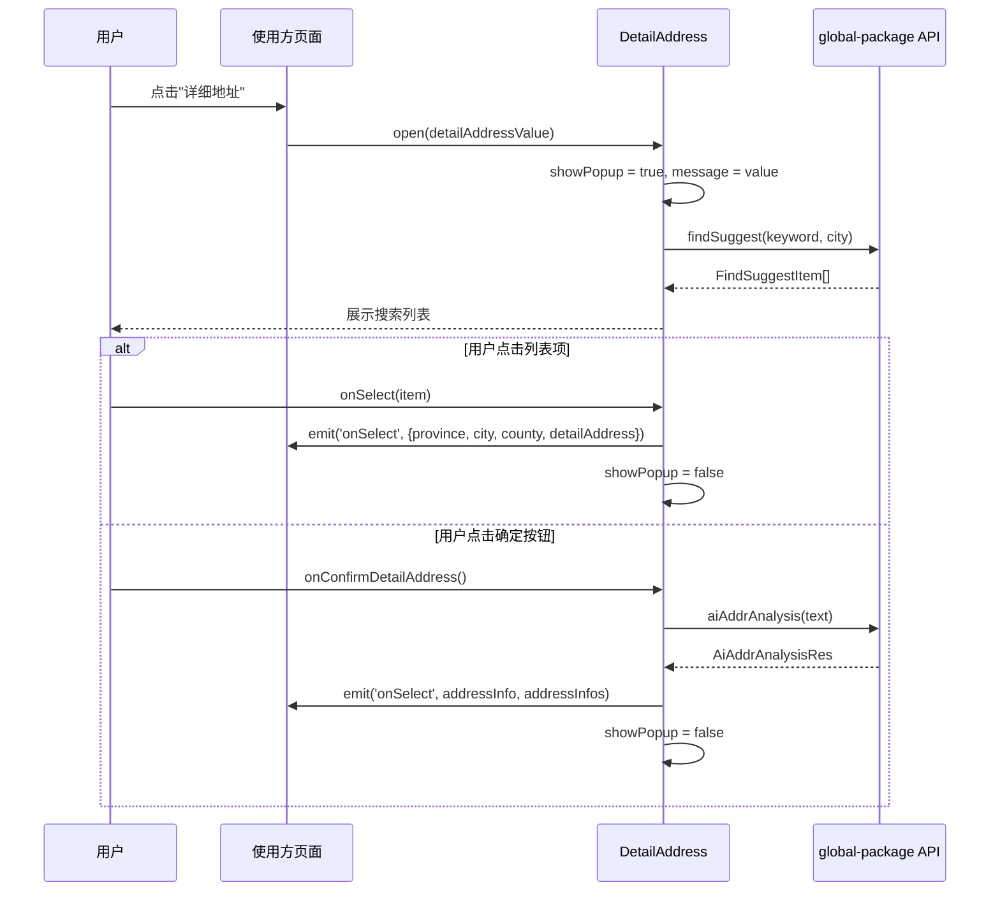

# Design: DetailAddress 组件迁移

## 架构概览

```
order-global-package/components/business/
├── detail-address/              ← 本次迁移目标
│   ├── index.vue                # 主组件（弹窗 + 搜索 + 列表 + AI 解析）
│   ├── types.ts                 # DetailAddressState 类型
│   ├── index.scss               # 样式
│   ├── readme.md                # 文档
│   ├── report/index.ts          # 埋点上报（注释函数体）
│   └── components/list/         # 地址列表项子组件
│       ├── index.vue
│       └── index.scss
├── base/
│   └── ky-textarea/             ← 一并迁移（多行文本输入）
└── ui/
    └── list-refresh-load/       ← 一并迁移（下拉刷新/上拉加载）
```

## 组件交互流程



## Props 接口设计

```typescript
interface PropsType {
  /** 地址类型: 'SENDER' | 'RECEIVE' */
  addressType: string
  /** 已选省市区数组 [省, 市, 区] */
  area: string[]
  /** 运单号（可选，AI 解析时使用） */
  waybillNumber?: string
}
```

**与原版差异**: 新增 `waybillNumber` prop 替代 `useStore().order.waybillNumber` 读取，实现 Store 解耦。

## Emits 接口设计

```typescript
const emit = defineEmits([
  'onConfirmDetailAddress',  // 确定 AI 解析回调
  'onSelect',                // 列表选中 / 确定解析 回调
  'getResolutionData',       // 解析完成通知
  'close',                   // 弹窗关闭
])
```

**完全兼容原版**，无变更。

## Expose 方法

```typescript
defineExpose({
  open,      // 打开弹窗, 参数: 当前详细地址字符串
  toFocus,   // 聚焦输入框
})
```

**完全兼容原版**。

## 关键改造细节

### 1. Pinia Store 解耦

**Before:**
```typescript
import { useStore } from '@order-public/store'
const piniaStore = useStore()
// ...
businessId: props?.waybillNumber || piniaStore.order.waybillNumber,
```

**After:**
```typescript
// 删除 useStore import
// 直接使用 props.waybillNumber，调用方传入
businessId: props?.waybillNumber || '',
```

### 2. useOriginalAddress 内联

**Before:**
```typescript
import { useOriginalAddress, ... } from '@order-public/hooks/address/useCommon'
// ...
useOriginalAddress.value = data.originalAddress || ''
```

**After:**
```typescript
// 内部 ref + 可选 emit 回传原始地址
const originalAddress = ref('')
// 在 onConfirmDetailAddress 中:
originalAddress.value = data.originalAddress || ''
emit('onOriginalAddress', originalAddress.value)  // 可选
```

### 3. Address 常量内联

**Before:**
```typescript
import { Address } from '@order-public/constants'
if (props.addressType === Address.SENDER) { ... }
```

**After:**
```typescript
if (props.addressType === 'SENDER' || props.addressType.toString() === '10') { ... }
```

### 4. getDetailAddressSceneType 内联

**Before:**
```typescript
import { getDetailAddressSceneType } from '@order-public/utils/waybillInfo'
sceneType: getDetailAddressSceneType(getAddressType(props.addressType)),
```

**After:**
```typescript
sceneType: getAddressType(props.addressType) === 10 ? 'sender' : 'receive',
```

### 5. 上报代码处理

所有 umpOtherReport 调用点注释保留:
```typescript
// nextTick(() => {
//   umpOtherReport('OTHER', {
//     eventCode: 'other_express_sender_address_perception_v1',
//   })
// })
```

report 函数体注释但保留签名:
```typescript
export const pasteReport = (value: string, addressType: string) => {
  // TODO: 上报功能待恢复
  // umpOtherReport(...)
}
```

## ListRefreshLoad 迁移评估

需确认其内部依赖：
- 若仅依赖 miniui/van-components → 可直接复制
- 若依赖 @order-public hooks/utils → 需同步解耦

## KyTextarea 迁移评估

需确认其内部依赖：
- 已在 order-global-package 中有 ky-textarea 目录占位
- 需检查原版完整实现和依赖链
