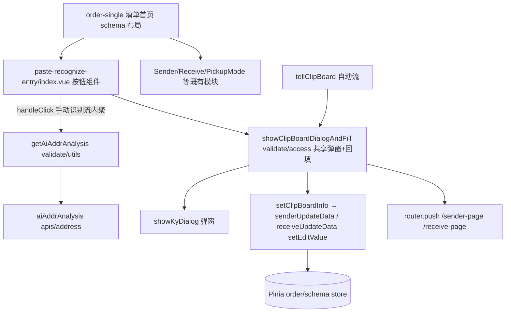
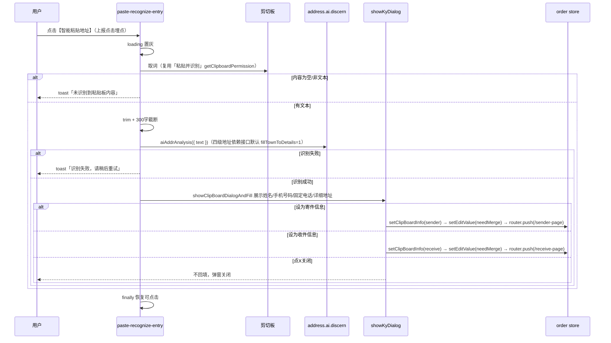

# Design: 快速寄件填单首页手动粘贴识别入口

---

## Context

用户在快速寄件填单首页需逐项手动填写寄收人信息，而剪切板中已有的「姓名+电话+地址」文本缺少手动触发的识别入口（现有粘贴板识别仅在进入下单页时自动触发一次）。本设计对应 proposal 中的能力：`paste-recognize-entry`，核心思路是在填单首页新增手动按钮，复用现有自动识别流程的取词、识别、弹窗与回填能力。

---

## Terminology

### 术语表

| **术语** | 定义 |
| ----------- | ------ |
| **快速寄件填单首页** | order-single 页面，展示 Banner、OrderCustomer、TemplateList、寄件人信息卡片、收件人信息卡片、寄件方式卡片、预估费用与下单按钮的首页 |
| **页面样式=跳转** | 下单配置中寄收信息模块的 `container === 'page'`，寄/收件人信息以卡片展示、点击跳转独立填写页；反之为平铺（`container` 非 page） |
| **组合条件/指定地址** | 下单配置中寄收信息的两种受限模式，此时寄收信息由配置控制，不允许自由粘贴回填 |
| **自动识别流** | 进入下单页时由 `filterCheckResultList` → `tellClipBoard` 触发的粘贴板识别流程（`CheckBeforeEnterType.识别粘贴板`） |
| **手动识别流** | 本次新增：用户点击【智能粘贴地址】按钮触发的识别流程，后续弹窗与回填逻辑与自动识别流一致 |
| **取词** | 调用 `Taro.getClipboardData()` 读取剪切板文本，trim 后按 300 字截断 |

---

## Goals / Non-Goals

### Goals

- 填单首页寄/收件人信息卡片与寄件方式卡片之间新增【智能粘贴地址】按钮，按白名单条件展示。
- 点击按钮完成「取词 → 识别（fillTownToDetails=1）→ 弹窗确认 → 按字段覆盖回填 + 跳转」完整链路，复用 `tellClipBoard` 现有弹窗与回填逻辑。

### Non-Goals

- 不改动自动识别流的触发时机、判定规则（省市区关键词 + 11 字下限 + 内容变化判断）与行为。
- 不调整现有弹窗标题与文案（保持「是否使用粘贴板中的地址」）。
- 仅新增按钮点击埋点（clk_express_smart_paste_v1）；不处理剪切板权限自定义弹窗（直接取词）；不支持支付宝小程序、高德小程序；不涉及图片识别。

---

## Decisions

### 1. 组件选型：新建轻量按钮组件，置于 order-public 业务组件目录

**决策内容**：在 `kye-miniapp-order/src/order-public/components/business/paste-recognize-entry/` 新建组件（index.vue + index.scss），仅包含图标+文案+按压热区（hover-class 背景 rgba(0,0,0,0.1)），样式独立 scss 文件。

**理由**：实现阶段应用户要求将组件下沉至 order-public 业务组件目录（原方案为 order-single 页面内组件），与 receive/page 等既有 business 组件同级，便于后续其他下单页面复用；组件全部使用 `@order-public` 别名引用，无页面级耦合。

**备选方案**：

- 直接在 order-single 页面模板内联按钮 markup —— 页面已 370+ 行，继续膨胀不利于维护，故不采用。

### 2. 识别流程复用：拆分 `tellClipBoard`，弹窗+回填抽为共享函数，手动流内聚在组件

**决策内容**：在 `kye-miniapp-order/src/order-public/validate/access/index.ts` 内将「识别结果弹窗（`showClipBoardDialog`）+ 寄/收回填跳转（`setClipBoardInfo`，type 参数控制，合并原 setReceive/setSenderByClipBoard）」抽为共享函数并导出 `showClipBoardDialogAndFill(res)`；自动流 `tellClipBoard` 改为调用共享函数。手动识别流（取词 → trim + 300 字截断 → 判空 toast → `getAiAddrAnalysis` → `showClipBoardDialogAndFill`）整体内聚在按钮组件 `index.vue` 内（应用户要求从 validate 层移入），validate 层不再导出独立手动入口函数。

**理由**：用户已确认「本质是自动触发之外增加手动触发，剩下流程一样」；共享弹窗回填可保证两条流程行为一致，且不改动自动流对外行为；手动流自治使组件即插即用。

**备选方案**：

- 手动流整体复制一套弹窗回填代码 —— 双份逻辑易漂移，违反复用原则，不采用。

### 3. 接口参数：不改动 `getAiAddrAnalysis`，依赖接口默认 fillTownToDetails=1

**决策内容**：`order-public/validate/utils.ts` 的 `getAiAddrAnalysis` 保持原签名不动；手动流直接调用，详细地址拼接四级地址依赖 address.ai.discern 接口默认值 `fillTownToDetails=1`（TY566999 ADDR-001）。

**理由**：实现阶段用户确认无需前端显式传参，保持既有封装零改动，缩小影响面。

**备选方案**：

- `getAiAddrAnalysis` 增加可选参数透传 `fillTownToDetails` —— 曾按此实现，后按用户要求还原。

### 4. 状态管理：无新增 Pinia state，loading 为组件内部状态

**决策内容**：按钮 loading（置灰防重复点击）用组件内部 `ref<boolean>`，且必须在 `finally` 中恢复，保证空内容/失败/弹窗关闭各路径均可再次点击；回填数据通过现有 `senderUpdateData/receiveUpdateData` 的 `setEditValue({ item, needMerge: true })` 写入 order store，不新增任何 state/getters/actions。

**理由**：回填路径完全复用自动流现成逻辑，新增 state 只会造成双份真相。

**备选方案**：无其他可行方案。

### 5. 路由：不新增路由，复用 `tellClipBoard` 回填后的跳转

**决策内容**：不新增路由与页面；「设为寄件信息/设为收件信息」后的跳转沿用现有逻辑——`moduleConfig.container === 'page'` 时 `router.push('/sender-page' | '/receive-page')`。本功能白名单要求页面样式=跳转，故跳转必然发生。

**理由**：需求「设为xxx需跳转对应页面」与现有 `setReceive`/寄件分支行为一致，无需改造。

**备选方案**：无其他可行方案。

### 6. 按钮展示条件：组件内集中判断白名单

**决策内容**：按钮 v-if 展示条件集中在组件 `showEntry` 计算属性内（实现阶段应用户要求由页面层判断改为组件自治）：`OrderPageType.单票` 且寄/收两模块均满足 `container === 'page'` 且 `fieldsConfigType === 'fields'`（≠组合条件/指定地址）且 `functionConfig.addressOcrVisible`（智能识别模块开启），且客户端仅微信（`isWxAppEnv || isWechatEnv`，支付宝/高德隐藏）。

**理由**：组件内聚白名单后即插即用，接入方（componentsMap + schema 插入）无需感知展示条件。

**备选方案**：

- 页面层集中判断后 props 下发、组件纯展示 —— 原设计，实现时按用户要求调整为组件自治。

### 7. 表单校验：沿用回填后的既有校验

**决策内容**：不新增表单校验规则；回填后沿用共享函数 `setClipBoardInfo` 现有行为——平铺样式（寄方平铺/收方平铺）回填后延迟 1s 触发 `remoteCheck(type)`（寄收行为一致，原寄件侧 `!isOrderPage()` 守卫移除），跳转场景由填写页自身校验兜底。

**理由**：识别结果字段（姓名/手机号/固话/地址）的合法性校验已在填写页与提交链路存在。

**备选方案**：无其他可行方案。

### 8. 埋点：仅新增按钮点击埋点

**决策内容**：组件 `handleClick` 入口调用 `umpOtherReport('CLK', { eventCode: 'clk_express_smart_paste_v1' })` 上报按钮点击；不新增其他埋点。

**理由**：实现阶段应用户要求补充点击埋点（原 proposal 依据需求功能清单「不需要埋点」，后按实际需要调整）。

---

## Risks / Trade-offs

| 决策 | 风险 / 权衡 | 缓解措施 |
| ---------- | ---------------- | ---------- |
| 拆分 `tellClipBoard` 抽共享函数 | 重构触及自动流，回归风险 | 仅做函数抽取不改逻辑分支；自动流回归验证「进入下单页弹窗」场景 |
| 手动流不更新 `clipboardData` 缓存 | 用户手动识别后，自动流可能对同一段内容再次弹窗 | 用户已拍板「每次点击每次获取」；自动流自身有 hasChange 判断，接受该行为 |
| 300 字截断后识别 | 截断可能丢失尾部地址信息导致识别质量下降 | 需求明确规定截断处理；产品已确认 |
| 直接取词无权限弹窗 | 微信端系统剪切板提示无法控制；iOS/Android 权限差异 | 与「粘贴并识别」现网行为一致；取词失败按空内容 toast 兜底 |
| `fillTownToDetails=1` 与其他场景（10）不一致 | 同一接口不同入参，排查问题时易混淆 | 在 `getAiAddrAnalysis` 参数注释标明来源（TY570232 / ADDR-001） |

---

## Architecture

### 目录结构

```
src/modules/kye-miniapp-order/src/            # 源码目录（构建后复制为 order-build-sub-pages）
├── pages/
│   └── order-single/
│       ├── components/
│       │   └── index.tsx                     # componentsMap 注册 paste-recognize-entry
│       └── hooks/
│           └── utils.ts                      # schema 合并后插入入口（幂等）
└── order-public/
    ├── apis/
    │   └── address/
    │       └── index.ts                      # aiAddrAnalysis（已有，不改）
    ├── components/
    │   └── business/
    │       └── paste-recognize-entry/
    │           ├── index.vue                 # 【智能粘贴地址】按钮组件（白名单+取词识别流+loading 内聚）
    │           └── index.scss                # 按钮样式（独立 scss，px 单位）
    └── validate/
        ├── utils.ts                          # getAiAddrAnalysis（已有，不改）
        └── access/
            └── index.ts                      # tellClipBoard 拆分：showClipBoardDialog + setClipBoardInfo + showClipBoardDialogAndFill
```

> ⚠️ 以下 `src/modules/order-build-sub-pages/`、`order-build/` 均为构建副本，禁止直接修改。

### 框架层级关系



### 核心业务流程



### 路由规划

| 路由路径 | 组件 | 参数 | 守卫 | 说明 |
| --------- | ------------- | ---------- | --------- | ------ |
| `/sender-page` | 既有寄件人填写页 | `addressType=SENDER_ADDRESS_TYPE&pageSource=page` | 既有 | 设为寄件信息后跳转（复用现有逻辑） |
| `/receive-page` | 既有收件人填写页 | `addressType=RECEIVE_ADDRESS_TYPE&pageSource=page` | 既有 | 设为收件信息后跳转（复用现有逻辑） |

不新增路由。

### 数据流向

| 方向 | 方式 | 场景 |
| ------- | ------------------------ | ------- |
| 组件 → Store | 组件自治读取 schema（`piniaStore.schema.moduleConfigData`）判断白名单 | showEntry 计算属性 |
| 组件 → 工具层 | 直接 import `showClipBoardDialogAndFill` / `getAiAddrAnalysis` | 手动识别流（取词识别在组件内完成） |
| 工具层 → Store | Pinia（`piniaStore.schema.moduleConfigData`、`setEditValue`） | 回填寄/收件信息 |

不使用 EventBus、不新增 genericCode 查询配置。

---

## Data Model

### 核心实体

#### 识别结果 AiAddrAnalysis（复用既有类型，不新增）

| 字段名 | 类型 | 必填 | 默认值 | 枚举/lookupCode | 示例 |
| ----------- | -------- | ------- | --------- | --------------- | -------- |
| person | `string` | 否 | `''` | - | 张三 |
| mobile | `string` | 否 | `''` | - | 13888888888 |
| telephone | `string` | 否 | `''` | - | 0755-23232111 |
| extension | `string` | 否 | `''` | - | 8001 |
| province | `string` | 否 | `''` | - | 广东省 |
| city | `string` | 否 | `''` | - | 深圳市 |
| county | `string` | 否 | `''` | - | 南山区 |
| detailAddress | `string` | 否 | `''` | - | 科技园XX路6号 |
| companyName | `string` | 否 | `''` | - | 跨越速运 |

#### 手动识别流状态（组件内部，非 Pinia）

| 字段名 | 类型 | 必填 | 默认值 | 说明 |
| ----------- | -------- | ------- | --------- | ------- |
| loading | `boolean` | 是 | `false` | 识别过程置灰防重复点击 |

### 状态管理（Pinia）

不新增 state/getters/actions。回填复用 `senderUpdateData/receiveUpdateData` 的 `setEditValue({ item, needMerge: true })` 写入既有 order store 的寄/收方信息模块表单。

### 表单定义

不新增表单字段。回填目标字段（person/mobile/telephone/detailAddress 等）的校验沿用填写页既有规则（required、手机号 11 位 pattern 等），本功能不改动。

---

## API Design

### 接口清单

| 方法 | 路径 | 描述 |
| ------ | ----------------- | ------ |
| `POST` | `address.ai.discern`（经 `aiAddrAnalysis` 封装） | AI 解析剪切板文本，返回结构化寄收信息 |

### address.ai.discern

**请求参数**：

| 参数名 | 类型 | 必填 | 说明 |
| ----------- | -------- | ------- | ------ |
| text | `string` | 是 | 剪切板文本（trim + 300 字截断后） |
| fillTownToDetails | `number` | 否 | 前端不显式传参，依赖接口默认值 `1`（详细地址拼接四级地址，TY566999 ADDR-001） |

**响应结构**：

| 字段名 | 类型 | 说明 |
| ----------- | -------- | ------ |
| addressInfos | `AiAddrAnalysis[]` | 解析结果数组，取第一条 |
| addressInfos[].name | `string` | 姓名 |
| addressInfos[].mobile / mobilePhone | `string` | 手机号 |
| addressInfos[].telephone / telPhone | `string` | 固定电话 |
| addressInfos[].province / city / district | `string` | 省/市/区 |
| addressInfos[].address / detailAddress | `string` | 详细地址 |
| addressInfos[].company | `string` | 公司名 |

**调用时机**：取词成功且文本非空时调用；每次点击按钮均重新取词、重新调用（不读缓存）。

**Loading 处理**：按钮置灰 + loading 态防重复点击，识别结束（成功/失败/弹窗关闭）后恢复。

**错误处理**：接口异常/返回失败 → toast「识别失败，请稍后重试」，不阻塞下单流程；解析字段为空不视为失败，弹窗内展示「未识别到xxx」。

---

## User Interface Design

### 页面布局

移动端单列布局，按钮插入于既有卡片流中间：

```
┌──────────────────────────┐
│  导航栏：快速寄件           │
├──────────────────────────┤
│  Banner / OrderCustomer   │
│  TemplateList             │
├──────────────────────────┤
│  ┌ 寄件人信息卡片 ┐        │
│  └ 收件人信息卡片 ┘        │
│  ┌──────────────────────┐ │
│  │  📋 智能粘贴地址       │ │  ← 新增：独立成行居中，图标+文案，按压态背景 rgba(0,0,0,0.1)
│  └──────────────────────┘ │
│  寄件方式卡片              │
│  预估费用 + 下单按钮        │
└──────────────────────────┘
```

### 状态说明

| 状态 | 展示方式 |
| ----------- | ------------------------------------ |
| **Loading** | 按钮置灰（禁用点击），识别结束后恢复 |
| **Empty** | 剪切板无文本/非文本 → toast「未识别到粘贴板内容」 |
| **Error** | 识别接口失败 → toast「识别失败，请稍后重试」，页面可继续正常下单 |

### 交互行为

#### 1. 点击【智能粘贴地址】

**触发条件**：按钮白名单满足时点击整个按钮热区（上报点击埋点 clk_express_smart_paste_v1）。

**交互链路**：

```pseudo
1. 用户点击按钮 → 上报埋点 → 按钮 loading 置灰
2. 复用「粘贴并识别」取词方式读取剪切板
3. 空内容 → toast「未识别到粘贴板内容」→ finally 恢复按钮，流程结束
4. 非空 → trim + 300 字截断 → aiAddrAnalysis({ text })（四级地址依赖接口默认 fillTownToDetails=1）
5. 识别失败 → toast「识别失败，请稍后重试」→ finally 恢复按钮
6. 识别成功 → 复用 tellClipBoard 弹窗（标题「是否使用粘贴板中的地址」）
7. 点【设为收件信息】→ setEditValue 合并回填 + router.push('/receive-page')
   点【设为寄件信息】→ setEditValue 合并回填 + router.push('/sender-page')
   点 X → 仅关闭弹窗，不回填
8. 恢复按钮可点击
```

**结果**：回填为按字段覆盖（needMerge），未解析出的字段保留用户已填原值不清空。

#### 2. 按钮展示/隐藏

**触发条件**：进入填单首页、下单配置初始化完成。

**交互链路**：

```pseudo
1. 组件读取下单配置 schema 与页面类型
2. 满足「OrderPageType.单票 且 container === 'page' 且 fieldsConfigType === 'fields' 且 addressOcrVisible 开启 且 客户端=微信」→ 渲染按钮
3. 任一条件不满足（含配置未维护/未设置）→ 不渲染
```

**结果**：白名单外一律隐藏，不占位。

### 列表配置

不涉及（本功能无列表）。

---

## Security & Performance

### 安全

| 类别 | 措施 | 说明 |
| ------------ | --------------------- | ------ |
| 敏感字段脱敏 | 不涉及 | 识别结果仅在本机弹窗展示，不上报明文（仅按钮点击埋点，不含内容） |
| 前端加密 | 不涉及 | 接口经统一 http() 携带 token/sign |
| 权限控制 | 按钮白名单即权限粒度 | 无菜单/按钮级 authCode，展示由下单配置数据驱动 |

### 权限控制

**页面级权限**：不涉及（order-single 页面既有登录/token 守卫不变）。

**按钮级权限**：不涉及（无 authCode，由白名单条件控制）。

### 性能

| 策略 | 方式 | 说明 |
| -------- | -------------------------------------------- | ------ |
| 缓存策略 | 不缓存剪切板内容（每次点击实时获取） | 用户已确认 |
| 懒加载 | 按钮组件轻量，随页面首屏渲染，无需异步加载 | 组件仅图标+文案 |
| 分页方式 | 不涉及 | 无列表 |
| 体积 | 新增 1 个小组件 + 少量逻辑改动 | 远低于分包 2MB / 总包 30MB 限制，无需专项评估 |

---

## Module Dependencies

### 受影响的模块

| 模块 | 影响范围 | 应对方式 |
| ------------ | ---------- | ---------- |
| `kye-miniapp-order/src/pages/order-single`（源码） | 模板插入按钮、新增白名单计算属性 | 只增不改既有结构 |
| `kye-miniapp-order/src/order-public/validate/access/index.ts`（源码） | 抽取共享弹窗回填函数、新增手动入口导出 | 纯函数抽取，自动流行为不变 |
| `kye-miniapp-order/src/order-public/validate/utils.ts`（源码） | `getAiAddrAnalysis` 增加可选参数 | 向后兼容，自动流调用点不变 |
| `src/modules/order-build-sub-pages/`、`order-build/` | 构建副本 | 禁止直接修改，由插件自动复制 |

### 依赖的工具/组件

| 名称 | 类型 | 版本 | 用途 |
| ------ | ------------------------- | -------- | ------ |
| showKyDialog | 公共组件方法（@kye-netc/kye-miniui / ky-miniui-lib） | 随主工程 | 识别结果弹窗（复用自动流既有调用） |
| Taro.getClipboardData | Taro API | Taro 4.1.2 | 取词 |
| senderUpdateData / receiveUpdateData | 工具函数（order-public） | 随子应用 | 回填寄/收件信息 |
| piniaStore.schema / order | Pinia store（order-public） | Pinia 3.0.2 | 读取下单配置、写入表单 |
| router | 子应用路由（order-public/router.ts） | 随子应用 | 跳转填写页 |
| showToast | 公共工具 | 随主工程 | toast 提示 |

### 依赖的后端服务

| 接口 | 方法 | 入参 | 出参 |
| -------- | -------------------- | ---------- | ---------- |
| `address.ai.discern` | POST | `text`（截断后文本）、`fillTownToDetails=1` | `addressInfos[]`（name/mobile/telephone/province/city/district/address/company） |

---

## Compatibility

### 新旧数据兼容

不涉及 —— 本功能只读剪切板与下单配置实时数据，不存储、不改版任何历史数据结构。

### 接口版本兼容

`getAiAddrAnalysis` 新增参数为可选，未传时行为与旧版完全一致（自动流零影响）；`fillTownToDetails=1` 为本次手动流新传入，后端按 TY566999 已定稿规则支持。

### 路由兼容

不涉及 —— 不新增、不修改任何路由；跳转目标为既有 `/sender-page`、`/receive-page`。

---

## Deliverables

| 类型 | 名称 | 用途 | 路径 |
| ----------------- | ------------------ | ------ | ------------ |
| 业务组件 | paste-recognize-entry | 快速寄件填单首页【智能粘贴地址】按钮（图标+文案+按压态+loading+白名单/取词识别流内聚） | `src/modules/kye-miniapp-order/src/order-public/components/business/paste-recognize-entry/` |
| 公共方法（拆分） | showClipBoardDialogAndFill / setClipBoardInfo | 自动流与手动流共享的弹窗与回填跳转 | `src/modules/kye-miniapp-order/src/order-public/validate/access/index.ts` |
