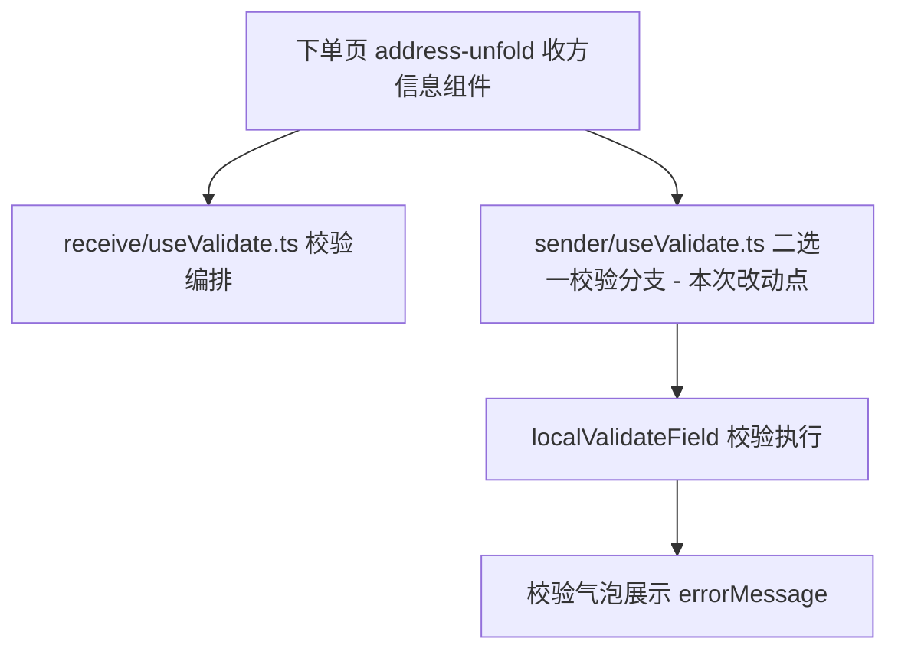
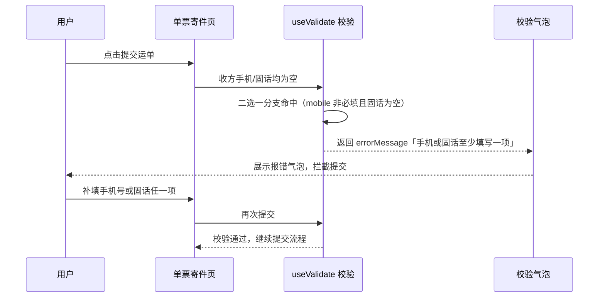

# Design: 单票寄件下单页报错文案精简

---

## Context

单票寄件下单页收方手机/固话均未填写时提交，触发「手机号码或固定电话至少填写一项」拦截气泡，文案表述冗长需精简为「手机或固话至少填写一项」。本设计对应 proposal 中的能力：order-page-copy。

---

## Terminology

### 术语表

| **术语**       | 定义                                                                   |
| -------------- | ---------------------------------------------------------------------- |
| **单票寄件**   | 小程序中一次提交一张运单的寄件模式，区别于批量下单                      |
| **二选一校验** | 收方手机号与固定电话均非必填时，要求两者至少填写一项的提交拦截规则      |
| **静默文案**   | 输入框未获焦、值为空时展示的占位提示文案（本仓库不涉及，仅 PC 端调整）  |
| **order-public** | kye-miniapp-order 子仓库内的公共代码目录，下单页寄/收方信息共用      |

---

## Goals / Non-Goals

### Goals

- 收方手机/固话二选一提交校验报错文案由「手机号码或固定电话至少填写一项」变更为「手机或固话至少填写一项」，微信/支付宝/H5 三端同步生效

### Non-Goals

- 不修改二选一校验规则、触发时机与提示气泡样式
- 不修改实名认证引导文案与区域限行文案（均由接口下发，属后端调整范围）
- 不修改寄/收方信息静默占位文案（需求明确仅 PC 端调整）
- 不新增埋点、不新增接口

---

## Decisions

### 1. 文案改动落点：直接修改校验规则内字符串

**决策内容**：在 `src/modules/kye-miniapp-order/src/order-public/hooks/address/sender/useValidate.ts` 中将二选一校验的 `errorMessage` 字符串直接替换为新文案，不抽取为常量或配置项。

**理由**：该文案在移动端源码中仅此一处（已全量检索确认），与同文件内其他 errorMessage 的写法保持一致（内联字符串），最小化变更面；抽取常量属于额外重构，超出本需求范围。

**备选方案**：

- 抽取为独立文案常量文件统一管理 — 该文件现有校验规则均为内联字符串，单独抽取一处会造成风格不一致，且改动面扩大，不采纳

### 2. 组件选型：沿用现有校验气泡机制

**决策内容**：不引入新组件，继续使用 `localValidateField` 返回校验结果并沿用现有气泡展示。

**理由**：本次仅文案文字变化，提示位置（表单项下方气泡）与样式同线上，需求明确「差异点：仅文案文字变化」。

**备选方案**：无其他可行方案

### 3. 状态管理：不涉及状态层变更

**决策内容**：不改 Pinia store、不新增状态。

**理由**：校验报错文案为校验规则内的即时返回值，不落 store。

**备选方案**：无其他可行方案

### 4. 路由与数据获取：不涉及

**决策内容**：无路由变更，无新增数据请求。

**理由**：纯展示文案调整，页面结构与请求链路均不变。

**备选方案**：无其他可行方案

### 5. 表单校验：仅替换错误文案，规则不动

**决策内容**：保留 `field === 'mobile' && !curRequired && !filterAllSpace(telephone)` 的二选一触发条件与 `notEmpty` 规则，仅变更 `errorMessage` 值。

**理由**：需求明确「触发条件不变」「填写任一项即可正常提交的逻辑同线上」。

**备选方案**：无其他可行方案

---

## Risks / Trade-offs

| 决策                     | 风险 / 权衡                                                                                             | 缓解措施                                                                                     |
| ------------------------ | ------------------------------------------------------------------------------------------------------- | -------------------------------------------------------------------------------------------- |
| 直接修改校验内字符串     | 该 errorMessage 为二选一校验链路共用，所有触发该提示的场景（下单页提交校验等）文案同步变化              | 新旧文案语义一致、长度更短，无截断风险；自测覆盖下单页收方手机/固话均空提交场景              |
| 改动位于 order-public 目录 | order-public 为寄/收方信息与地址簿共用代码，需确认改动不影响其他场景展示                               | 仅文案字符串变化，逻辑零改动；自测时覆盖下单页与寄件人信息页提交链路                        |

---

## Architecture

### 目录结构

```
src/modules/kye-miniapp-order/src/
└── order-public/
    └── hooks/
        └── address/
            └── sender/
                └── useValidate.ts    # 【本次唯一改动文件】二选一校验 errorMessage 替换
```

> 真实源码位于 `src/modules/kye-miniapp-order/src/`（子仓库源）；`src/modules/order-build/`、`order-build-sub-pages/` 等为构建副本，由 @kye-netc/miniapp-plugins 插件生成，禁止手动修改。

### 框架层级关系



### 核心业务流程



### 路由规划

| 路由路径 | 组件 | 参数 | 守卫 | 说明 |
| -------- | ---- | ---- | ---- | ---- |
| 暂无 | 暂无 | 暂无 | 暂无 | 不涉及路由变更 |

### 数据流向

| 方向    | 方式                     | 场景                             |
| ------- | ------------------------ | -------------------------------- |
| 父 → 子 | props                    | 收方信息组件向校验 hook 传配置（现有链路，不变） |
| 子 → 父 | 返回值                   | validateField 返回 localCheckResult 供气泡展示（现有链路，不变） |
| 跨组件  | Pinia store              | 表单数据读取（现有链路，不变）   |

---

## Data Model

### 核心实体

暂无（不涉及数据实体、Pinia state/getters/actions 与表单结构变更）。

---

## API Design

### 接口清单

| 方法 | 路径 | 描述 |
| ---- | ---- | ---- |
| 暂无 | 暂无 | 不涉及接口变更，本次无新增/修改接口 |

---

## User Interface Design

### 页面布局

不涉及布局变更。报错气泡沿用现有展示位置（触发校验的表单项下方），文案长度由 14 字缩短为 11 字，单行气泡宽度内完整展示。

### 状态说明

| 状态        | 展示方式                                   |
| ----------- | ------------------------------------------ |
| **Loading** | 不涉及（提交 Loading 逻辑同线上）          |
| **Empty**   | 不涉及                                     |
| **Error**   | 校验气泡展示新文案「手机或固话至少填写一项」 |

### 交互行为

#### 1. 收方手机/固话均空时提交拦截

**触发条件**：单票寄件页收方手机号与固定电话均未填写，点击提交运单。

**交互链路**：

```pseudo
1. 用户点击「提交」→ 触发收方信息校验
2. mobile 字段非必填且 telephone 为空 → 二选一分支命中
3. localValidateField 返回 { passed: false, content: '手机或固话至少填写一项' }
4. 页面在校验字段下方展示报错气泡，提交被拦截
5. 用户补填任一项后重新提交 → 校验通过
```

**结果**：报错文案为新精简文案，其余行为同线上。

### 列表配置

暂无（页面无列表）。

---

## Security & Performance

### 安全

| 类别         | 措施 | 说明                       |
| ------------ | ---- | -------------------------- |
| 敏感字段脱敏 | 暂无 | 不涉及敏感字段处理变更     |
| 前端加密     | 暂无 | 不涉及加密场景变更         |

### 权限控制

**页面级权限**：不涉及（下单页权限同线上，无菜单/路由守卫变更）

**按钮级权限**：不涉及（无按钮权限变更）

### 性能

| 策略     | 方式 | 说明                                       |
| -------- | ---- | ------------------------------------------ |
| 缓存策略 | 暂无 | 不涉及                                     |
| 懒加载   | 暂无 | 不涉及                                     |
| 分页方式 | 暂无 | 不涉及                                     |

> 体积影响：单行字符串替换，对分包 2MB / 总包 30MB 限制无影响。

---

## Module Dependencies

### 受影响的模块

| 模块                            | 影响范围                                                                                     | 应对方式                                                       |
| ------------------------------- | --------------------------------------------------------------------------------------------- | -------------------------------------------------------------- |
| kye-miniapp-order（order-public） | `hooks/address/sender/useValidate.ts` 二选一校验分支的 errorMessage；副本目录同步受影响但自动生成 | 仅改源码目录 `src/modules/kye-miniapp-order/src/`，副本随构建刷新 |

### 依赖的工具/组件

| 名称                 | 类型     | 版本                       | 用途                       |
| -------------------- | -------- | -------------------------- | -------------------------- |
| `notEmpty`           | 工具方法 | 项目内 `@order-public/utils/pattern` | 二选一校验规则（沿用，不变） |
| `filterAllSpace`     | 工具方法 | 项目内公共工具             | 过滤空白字符（沿用，不变） |
| `localValidateField` | 工具方法 | order-public 校验工具      | 执行字段校验（沿用，不变） |

### 依赖的后端服务

| 接口 | 方法 | 入参 | 出参 |
| ---- | ---- | ---- | ---- |
| 暂无 | 暂无 | 暂无 | 暂无（本次不涉及后端接口；实名认证文案与限行文案的后端调整由后端团队另行处理） |

---

## Compatibility

### 新旧数据兼容

不涉及：纯展示文案调整，无数据结构变更，历史运单数据展示不受影响。

### 接口版本兼容

不涉及：无接口变更。

### 路由兼容

不涉及：无路由变更。

---

## Deliverables

本次无公共产出（单行文案字符串替换，无可抽离的公共组件、工具函数或配置）。
