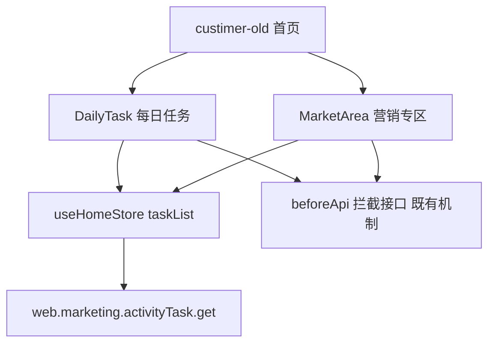
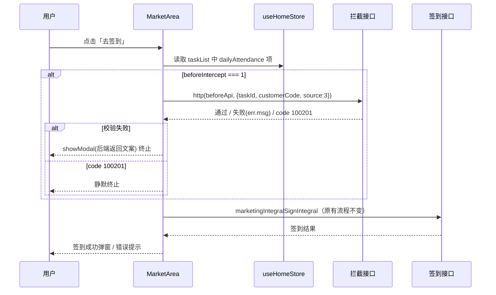

# Design: daily-task-account-control

---

## Context

首页每日任务板块的任务项显隐改由后端接口 `web.marketing.activityTask.get` 控制，前端需要补齐「列表为空时整板块隐藏」的渲染逻辑；微信端板块外的签到入口需要复用现有 `beforeIntercept + beforeApi` 拦截机制。本设计对应 proposal 中的能力：daily-task-account-control。

---

## Terminology

### 术语表

| **术语** | 定义 |
| --- | --- |
| **账号管控** | CRM 侧对客户账号的限制状态，本次涉及的管控类型为冻结（限消费、限送分） |
| **beforeIntercept** | 任务项字段，0 表示无前置拦截，1 表示执行跳转/请求前需先调 beforeApi 校验 |
| **beforeApi** | 任务项字段，前置拦截校验的接口编码，本次新增 `web.marketing.activityTaskBiz.checkIntegralAccountBeforeIntercept` |
| **dailyAttendance** | 每日签到任务的 taskCode；微信端签到入口在每日任务板块外（营销专区），不在板块列表内渲染 |
| **100201** | 拦截接口的静默错误码：前端终止流程且不弹窗提示 |

---

## Goals / Non-Goals

### Goals

- 每日任务板块在任务列表为空时整块隐藏（含标题），覆盖微信小程序与 APP
- 微信端营销专区签到入口接入 beforeApi 前置拦截，配置从 store 任务列表读取（方案 B）
- 拦截失败文案取后端返回，错误码 100201 静默终止

### Non-Goals

- 不改动 homeCache 持久化机制与刷新节点调用时机（均为现有逻辑）
- 不修正 `dailyAttendanceTaskId` 恒为 0 的存量问题，签到接口 `signIntegral` 参数维持现状
- 不在前端实现绑码状态、管控结果的判定逻辑（由后端接口控制 detailList 下发项）
- 不新增拦截弹窗组件，沿用现有 `Taro.showModal` 提示模式

---

## Decisions

### 1. 整板块隐藏实现方式

**决策内容**：在 daily-task 组件根节点 `<view class="daily-task">` 上增加 `v-if="taskList.length"`，判定数据源为组件内现有 `taskList` computed（微信端已过滤 dailyAttendance）。

**理由**：微信与 APP 共用 daily-task 组件（同页渲染于 custimer-old），组件内改动双端同时生效；微信端后端仍下发 dailyAttendance 项，过滤后列表为空即等价于「去下单、去寄件、去评价全部隐藏」，v-if 判定准确。

**备选方案**：

- 在 custimer-old 页面层用 store 数据做条件渲染——需要区分端差异重复实现过滤逻辑，且 alipay/H5 端渲染同一页面组件需同步维护，改动面更大，弃用。

### 2. 签到入口拦截配置来源（方案 B）

**决策内容**：market-area 的 toSign 从 `useHomeStore().data.taskList` 中查找 `taskCode === 'dailyAttendance'` 的任务项，读取其 `beforeIntercept/beforeApi` 字段决定是否拦截。

**理由**：store.taskList 为全量数据（daily-task 组件的过滤仅发生在渲染层），market-area 可零请求读取配置；保留后端可配置能力（后端调整 beforeApi 无需前端发版）；后端已确认管控/未绑码用户仍正常下发 dailyAttendance 项，数据链路无死角。

**备选方案**：

- 方案 A：前端写死调用 `web.marketing.activityTaskBiz.checkIntegralAccountBeforeIntercept`——实现简单但失去配置化能力，仅在方案 B 数据链路失效时作为退路，本次不采用。

### 3. 拦截失败处理复用现有模式

**决策内容**：拦截接口调用失败时，`typeof err === 'string'` 弹窗展示 err；对象错误时 `err.code !== 100201` 弹窗展示 `err.msg`；两种情况均终止签到流程。弹窗使用 `Taro.showModal`（title「温馨提示」、confirmText「我知道了」），与 toSign 现有员工提示弹窗样式一致。

**理由**：与 daily-task 组件现有 `beforeIntercept` catch 处理及 market-area 现有弹窗风格完全一致，不引入新交互模式；文案由后端返回，满足不写死要求。

**备选方案**：

- `Taro.showToast` 轻提示——展示时长短，管控提示需要用户确认感知，弹窗更符合场景，弃用。

### 4. 拦截校验的插入位置

**决策内容**：校验插入在 `isEmployee` 内部员工校验之后、`isSign` 已签到判断之前。

**理由**：员工校验优先级更高（员工提示语义明确，不受账号管控影响）；已签到用户跳积分页无需管控校验，放在其后可减少无效请求。

**备选方案**：

- 插在 toSign 最前部——员工用户先看到管控弹窗语义混乱，弃用。

### 5. 数据获取与状态管理

**决策内容**：复用 `useHomeStore` 的 `data.taskList`（Pinia，随 `getDailyTask` action 更新并持久化 homeCache），不新增 store 字段、不新增请求。

**理由**：拦截所需 `id/beforeIntercept/beforeApi` 均已在任务项数据结构中（`DailyTask['detailList']` 类型已定义），零数据模型变更。

**备选方案**：

- 新增独立接口实时查询拦截配置——增加请求数与后端改动，与「复用现有机制」的收窄口径冲突，弃用。

### 6. 路由与表单校验

**决策内容**：本次无新路由、无表单，不涉及路由守卫与表单校验设计；组件内跳转逻辑（`navigateToApp`、`Taro.navigateTo`）维持现状。

**理由**：改动范围仅限渲染条件与点击拦截，不触达路由与表单层。

**备选方案**：无其他可行方案。

---

## Risks / Trade-offs

| 决策 | 风险 / 权衡 | 缓解措施 |
| --- | --- | --- |
| 方案 B 配置化拦截 | taskList 走 homeCache 持久化，缓存的 beforeIntercept/beforeApi 为旧配置时，拦截行为滞后 | 属既有拦截兜底定位（状态漂移场景由后端兜底），已确认保留现状 |
| 方案 B 配置化拦截 | getDailyTask 失败走 defaultTaskList 兜底时，签到项 beforeIntercept 为 0，无拦截 | 沿用 PRD 4.1.1 既有降级口径，由后端与 CRM 侧兜底 |
| 方案 B 配置化拦截 | 任务列表未加载完成时秒点签到，无配置跳过拦截 | 等价 beforeIntercept 缺省 0 的现有语义，接受 |
| v-if 整块隐藏 | 微信端依赖「后端仍下发 dailyAttendance 项」这一前提，若后端调整下发策略，空列表判定失效（板块隐藏）但签到入口拦截配置同时丢失 | 已与后端确认为接口契约；联调验收时列为检查项 |

---

## Architecture

### 目录结构

```
src/layout/pages/home/
├── components/
│   ├── daily-task/
│   │   └── index.vue              # 【改】根节点增加 v-if="taskList.length"
│   ├── market-area/
│   │   └── index.vue              # 【改】toSign 增加拦截校验、函数声明改箭头函数
│   └── custimer-old/
│       └── index.vue              # 【不改】DailyTask/MarketArea 挂载处，双端共用
├── store/
│   └── index.ts                   # 【不改】taskList 数据源（getDailyTask action 既有）
└── apis/
    ├── index.ts                   # 【不改】拦截接口经 http() 按 apiCode 动态调用，无需新增函数
    └── types.ts                   # 【不改】DailyTask detailList 已含 beforeIntercept/beforeApi 字段
```

### 框架层级关系



### 核心业务流程



### 路由规划

不涉及，本次无新增路由与守卫。

### 数据流向

| 方向 | 方式 | 场景 |
| --- | --- | --- |
| 组件 → Pinia store | `useHomeStore().data.taskList` 读取 | daily-task 渲染、market-area 读取拦截配置 |
| store → 组件 | Pinia 响应式更新 | getDailyTask action 更新 taskList 后自动触发两组件重渲染 |
| 子 → 父 | `defineEmits`（既有 sign-success / sign-success-new） | 签到成功通知首页弹窗，本次不改动 |

---

## Data Model

### 核心实体

#### 任务项（DailyTask detailList 元素，本次消费字段）

| 字段名 | 类型 | 必填 | 默认值 | 枚举/lookupCode | 示例 |
| --- | --- | --- | --- | --- | --- |
| id | `number` | 是 | 无 | 无 | 3 |
| taskCode | `string \| null` | 否 | null | 无（签到固定 `dailyAttendance`） | dailyAttendance |
| beforeIntercept | `number` | 否 | 0 | 0 无拦截 / 1 拦截 | 1 |
| beforeApi | `string \| null` | 否 | null | 无 | web.marketing.activityTaskBiz.checkIntegralAccountBeforeIntercept |

### 状态管理（Pinia）

复用 `useHomeStore` 既有 state，本次零变更：

```typescript
// src/layout/pages/home/store/index.ts（引用示意，无新增）

// state.data.taskList: DailyTask['detailList']  // 每日任务列表，含 dailyAttendance 项
// actions.getDailyTask()                        // 拉取 web.marketing.activityTask.get，失败降级 defaultTaskList
```

### 表单定义

不涉及，本次无表单。

### 通用查询配置

不涉及，本次无 genericCode 配置。

---

## API Design

### 接口清单

| 方法 | 路径 | 描述 |
| --- | --- | --- |
| `POST` | `web.marketing.activityTask.get` | 每日任务列表（既有，后端控制管控用户的下发项） |
| `POST` | `web.marketing.activityTaskBiz.checkIntegralAccountBeforeIntercept` | 送分账号管控前置校验（新增，经任务项 beforeApi 字段动态调用） |
| `POST` | `web.marketing.integral.signIntegral` | 签到送积分（既有，参数不变） |

### checkIntegralAccountBeforeIntercept

**请求参数**：

| 参数名 | 类型 | 必填 | 说明 |
| --- | --- | --- | --- |
| taskId | `number` | 是 | 任务项 id，取列表项 item.id（区别于签到接口的存量 dailyAttendanceTaskId） |
| customerCode | `string \| undefined` | 否 | 客户编码，取 useBindCustomer 的 customerInfo |
| source | `number` | 是 | 固定 3，沿用现有拦截参数模式 |

**响应结构**：

| 字段名 | 类型 | 说明 |
| --- | --- | --- |
| code | `number` | 0 成功；100201 静默拦截；其他为业务失败 |
| msg | `string` | 失败时的弹窗文案（如「账户限送分及消费，请联系专属商务」） |

**调用时机**：toSign 中任务项 beforeIntercept === 1 时，在内部员工校验之后、已签到判断之前调用。

**Loading 处理**：不单独展示 Loading，校验请求轻量快速返回（沿用 daily-task 现有拦截调用 hideToast 静默模式）。

**错误处理**：`typeof err === 'string'` → showModal(err)；`err.code === 100201` → 静默 return；其他对象错误 → showModal(err.msg)。均终止签到流程。

---

## User Interface Design

### 页面布局

复用首页既有布局，无结构变化：

```
┌──────────────────────┐
│  搜索区               │
├──────────────────────┤
│  FastShipping        │
│  LightApp 金刚区      │
│  BindCode 绑码引导    │
│  CouponPackage       │
│  MarketArea 营销专区  │ ← 签到入口拦截（仅微信端渲染）
├──────────────────────┤
│  TodoList            │
├──────────────────────┤
│  DailyTask 每日任务   │ ← v-if="taskList.length" 整块隐藏
├──────────────────────┤
│  Footer / TabBar     │
└──────────────────────┘
```

### 状态说明

| 状态 | 展示方式 |
| --- | --- |
| **Loading** | 签到接口调用时沿用现有 `Taro.showLoading`；拦截校验请求静默无 Loading |
| **Empty** | 任务列表为空 → 每日任务板块整体不渲染（本次新增）；营销专区空列表隐藏为既有逻辑 |
| **Error** | 拦截失败 → showModal 展示后端文案；任务接口失败 → 降级 defaultTaskList 兜底渲染（既有） |

### 交互行为

#### 1. 点击「去签到」

**触发条件**：用户点击营销专区签到卡片。

**交互链路**：

```pseudo
1. 埋点上报（既有）→ 未登录跳登录页（既有）
2. isEmployee 为真 → showModal 内部员工提示，终止（既有）
3. 任务项 beforeIntercept === 1 → await http(beforeApi, params)
   3a. 通过 → 继续
   3b. 失败 → showModal(err.msg / err)，return
   3c. code === 100201 → 静默 return
4. isSign 为真 → 跳转积分签到页（既有）；否则调 signIntegral 签到（既有）
```

**结果**：拦截失败终止于弹窗；通过则进入原有签到流程，成功弹积分弹窗，失败展示接口错误信息。

### 列表配置

不涉及分页；每日任务列表项由接口 detailList 一次性下发，排序沿用接口 sort 字段。

---

## Security & Performance

### 安全

| 类别 | 措施 | 说明 |
| --- | --- | --- |
| 敏感字段脱敏 | 不涉及 | 本次无敏感字段展示 |
| 前端加密 | 不涉及 | 请求经 http() 统一携带 token/sign |
| 权限控制 | 不涉及 | C 端展示逻辑，无铸剑菜单/按钮权限（见 proposal 影响说明） |

### 权限控制

**页面级权限**：不涉及，首页无新增菜单与路由守卫。

**按钮级权限**：不涉及，无 authCode 要求。

### 性能

| 策略 | 方式 | 说明 |
| --- | --- | --- |
| 缓存策略 | homeCache（Taro storage） | 既有机制，本次保留 |
| 懒加载 | 不新增 | 无新组件/路由 |
| 分页方式 | 不涉及 | 任务列表一次性下发 |
| 包体影响 | 无新增依赖 | 满足分包 2MB / 总包 30MB 限制 |

---

## Module Dependencies

### 受影响的模块

| 模块 | 影响范围 | 应对方式 |
| --- | --- | --- |
| `src/layout/pages/home/components/daily-task/` | 根节点渲染条件 | 模板增加 v-if，脚本零改动 |
| `src/layout/pages/home/components/market-area/` | toSign 函数 | 增加拦截校验，函数声明改箭头函数 |
| `src/layout/pages/home/store/` | 无代码改动 | 仅作为数据源被读取 |
| `-build` 副本目录（order-build 等） | 不涉及 | 本次改动均在主应用 src/layout 下，非子应用源码 |

### 依赖的工具/组件

| 名称 | 类型 | 版本 | 用途 |
| --- | --- | --- | --- |
| `http()` | 工具方法（@public/utils/request） | 项目内置 | 拦截接口调用（hideToast 模式） |
| `useBindCustomer` | 公共 hooks | 项目内置 | 获取 customerInfo.customerCode |
| `useHomeStore` | Pinia store（项目内） | Pinia 3.0.2 | 读取 taskList |
| `Taro.showModal / showLoading` | Taro API | Taro 4.1.2 | 弹窗与 Loading |
| `ky-button` | UI 组件（@kye-netc/kye-miniui） | 项目内置 | 既有任务按钮，本次不改动 |

### 依赖的后端服务

| 接口 | 方法 | 入参 | 出参 |
| --- | --- | --- | --- |
| `web.marketing.activityTask.get` | POST | phone, customerCode, source(6 支付宝/7 其他), taskTypeCode=homePage | detailList[]（含 id/taskCode/beforeIntercept/beforeApi/gotoType/gotoLink 等） |
| `web.marketing.activityTaskBiz.checkIntegralAccountBeforeIntercept` | POST | taskId, customerCode, source=3 | code（0/100201/其他）、msg |
| `web.marketing.integral.signIntegral` | POST | taskId(存量 dailyAttendanceTaskId), customerCode, source=3 | data.integralAmount |

---

## Compatibility

### 新旧数据兼容

不涉及：本次无数据结构变更，taskList 既有字段消费不变，homeCache 旧缓存结构可直接使用。

### 接口版本兼容

拦截配置由任务项 `beforeIntercept/beforeApi` 字段驱动：后端未配置时（字段缺省或为 0/null）前端跳过校验，天然兼容灰度期未配置用户；无需区分新旧接口返回格式。

### 路由兼容

不涉及：本次无路由变更。

---

## Deliverables

本次无公共产出：改动收敛在 home 模块两个组件内，拦截逻辑完全复用既有 beforeIntercept 机制与数据结构，无抽离为公共组件/方法/配置的产出。
