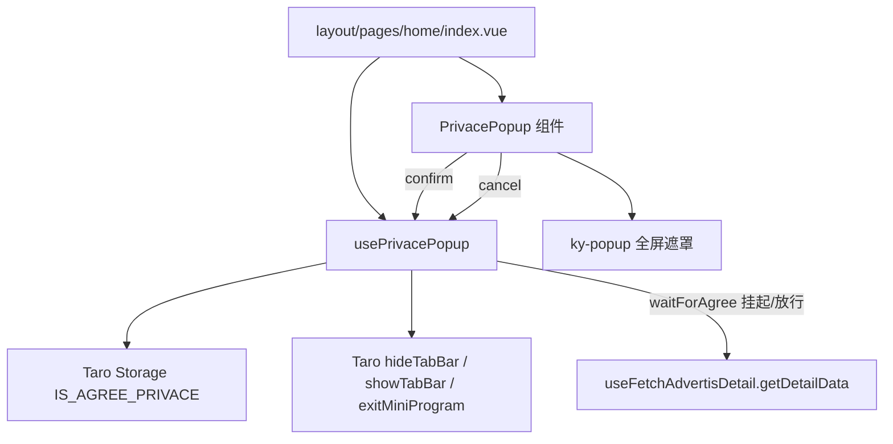
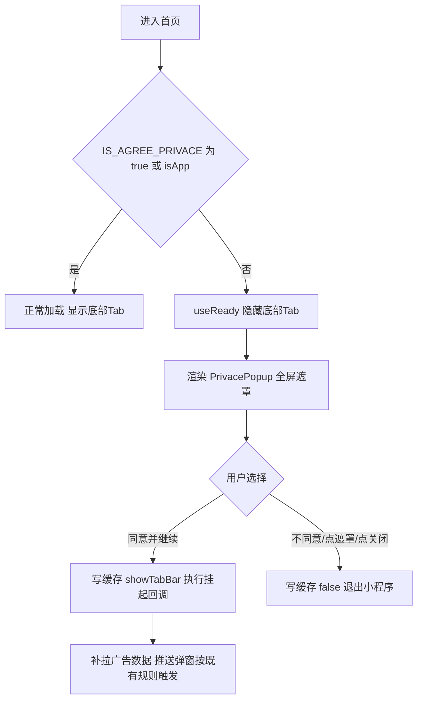

# Design: privacy-consent-gate

## Context

对应 proposal 能力 `privacy-consent-gate`：小程序（微信/支付宝）首次打开时强制隐私确认门禁。仓内已有底部弹层组件 `PrivacePopup` 与缓存键 `IS_AGREE_PRIVACE`，本次在其上收口为统一 Hook `usePrivacePopup`，并在首页接入"隐藏底部 Tab + 广告拉取同意前置拦截"。设计前提：Taro 4 + Vue3 `<script setup>`，门禁仅作用于小程序环境，App 容器与 H5 不做强制拦截。

## Terminology

- **隐私确认弹窗**：`PrivacePopup`（`src/public/components/business/privacy-popup/index.vue`），ky-popup 底部弹层，含【同意并继续】/【不同意】按钮
- **同意状态**：本地缓存键 `IS_AGREE_PRIVACE`（boolean），仅端内存储，服务器不存
- **精准通知推送弹窗**：广告中心 `AdvertisePopup`（adType `'20'`）及其同源的浮层/banner/notice，由 `useFetchAdvertisDetail.getDetailData` 拉取
- **底部四 Tab**：原生 tabBar（`src/wx.config.ts` / `src/alipay.config.ts`），首页/寄件/查件/我的
- **App 容器**：`getEnvConfig().isApp`，H5 内嵌于 App 的场景，视为已同意

## Goals / Non-Goals

**Goals:**

- 首次打开（或删除小程序/清除缓存后重新打开）进入首页即触发隐私确认弹窗，未选择前隐藏底部四 Tab、遮罩锁定页面交互
- 点击【同意并继续】后记录同意状态、恢复底部 Tab、解锁全部功能，精准通知推送弹窗按既有规则触发
- 点击【不同意】后退出小程序（H5 环境除外）
- 未同意状态下首页三个数据分支（新客/未登录/老客）的广告拉取全部阻断

**Non-Goals:**

- 不改造 App 原生端（App 团队单独处理）
- 不修改隐私政策文案与协议详情页
- 不改造后端个人信息采集接口
- 不覆盖 mine/order 页的广告拉取门控与深链直达其他 tab 页的场景（本期范围以首页入口为准）
- 不新增埋点（PRD 埋点实施待确认，本期不做）
- 不接入微信平台 `__usePrivacyCheck__` / `onNeedPrivacyAuthorization` 官方隐私接口

## Decisions

### 决策 1：门禁状态管理 —— Hook 内 ref + Taro 本地缓存

**决策内容**：`usePrivacePopup` 内 `isAgree = ref(!!Taro.getStorageSync('IS_AGREE_PRIVACE') || isApp)`，每次调用独立实例；同意状态持久化仅用 `Taro.setStorageSync`。
**理由**：当前仅首页一个消费方，Hook 级状态足够；删除小程序/清除缓存后缓存键消失，天然满足"重新触发"要求，无需额外版本号或过期逻辑。
**备选方案**：Pinia store 全局共享。依据：当前单页消费，引入 store 增加无收益的状态同步成本；后续接入多页面时再提升为共享状态。

### 决策 2：弹窗组件选型 —— 复用既有 `PrivacePopup`

**决策内容**：沿用 `src/public/components/business/privacy-popup/index.vue`（ky-popup `position="bottom"` + 全屏遮罩 `closeOnClickOverlay=false`），首页通过 `createAsyncComp(..., 1000)` 异步加载。
**理由**：PRD 明确要求保留现有温馨提示弹窗样式，仅将交互由"可绕过"改为"强制选择"；遮罩组件已具备 `catchtouchmove` 与点击穿透阻断能力。
**备选方案**：微信官方隐私弹窗（`wx.requirePrivacyAuthorize`）。依据：官方机制只管控隐私 API 调用授权，不提供隐藏底部 Tab 与锁定功能入口的 UI 能力，不满足验收标准。

### 决策 3：底部 Tab 隐藏 —— 原生 `Taro.hideTabBar/showTabBar`

**决策内容**：`useReady` 时未同意则 `hideTabBar`；同意后 `showTabBar`，`fail` 回调内 100ms `setTimeout` 重试一次兜底。
**理由**：tabBar 为原生配置（非 custom-tab-bar），无组件级 v-if 可用，只能走原生 API；`showTabBar` 在页面渲染时序冲突下存在失败分支，重试兜底避免 Tab 永久丢失。
**备选方案**：切换 custom-tab-bar 自定义组件。依据：四个 tab 页全部改造，成本与回归面远超本次需求。

### 决策 4：推送弹窗拦截 —— `waitForAgree` 挂起回调包装数据拉取

**决策内容**：`waitForAgree(onAlreadyAgreed, onPendingAgree)`：已同意立即执行 `onAlreadyAgreed`；未同意将 `onAlreadyAgreed` 存入 `manualAgreeCallback` 挂起并执行 `onPendingAgree`（首页用于复位 `isFetching`），`agreePrivace()` 时执行并清空挂起回调。
**理由**：广告弹窗由数据驱动（`result.popup` 存在即展示），阻断拉取等于阻断弹窗；挂起模式保证同意后数据自动补拉，用户无感知。
**备选方案**：在 `getDetailData` 内统一拦截。依据：本期范围仅首页，保持 Hook 调用方显式包装，拦截点清晰可审计。

### 决策 5：路由与守卫 —— 无路由改动

**决策内容**：不新增路由、不加导航守卫；门禁以"首页页内弹窗 + 隐藏原生 tabBar"实现。
**理由**：小程序 tab 页无法通过路由守卫拦截原生 tabBar 渲染，页内 Hook 是可落地的最小方案。
**备选方案**：`app.ts onLaunch` 检测未同意强制 `reLaunch` 首页。依据：reLaunch 存在首页闪烁，且本期范围不含深链直达场景。

### 决策 6：表单校验 —— 不涉及

**决策内容**：本能力无表单，无校验规则。
**备选方案**：无其他可行方案。

## Risks / Trade-offs

| 风险/权衡 | 说明 | 应对 |
| --- | --- | --- |
| 单回调槽位 | `manualAgreeCallback` 仅存一个回调，同意前多次触发 `waitForAgree` 会覆盖先前回调，早先的广告拉取在同意后不补执行 | 首页同一时刻仅一个数据分支（新客/未登录/老客）活跃，接受该限制；后续多页面接入时改为回调数组 |
| Hook 状态不共享 | 多次调用 `usePrivacePopup()` 生成独立 `isAgree`，跨页面接入时同意动作无法互通 | 本期仅首页消费；多页面接入时提升为模块级单例或 Pinia store |
| `showTabBar` 时序失败 | 弹窗关闭与原生 tabBar 恢复存在渲染时序冲突，`fail` 分支兜底重试带来最多 100ms 延迟 | 已内置一次性重试 |
| 不同意退出能力 | 支付宝端 `Taro.exitMiniProgram` 行为未实测；退出失败时 `isAgree` 已置 true，页面解锁但缓存为 false，下次打开重新弹窗 | PRD 兜底口径为"停留弹窗页保持锁定"，该差异列入测试验证项 |
| 首启挂载窗口 | `PrivacePopup` 异步组件延迟 1000ms 挂载，此期间 tabBar 已被 `useReady` 隐藏，页面功能入口在遮罩出现前处于可点状态 | 首页数据拉取已被 `waitForAgree` 阻断，窗口期内无可触发的推送弹窗；页面点击在该窗口期不作拦截 |
| 按钮文案口径 | 需求原始文档字段口径表固定文案为【同意】，实现与 spec 均为【同意并继续】 | 已确认以代码实现为准，spec 按实现描述，需求原文差异由产品侧豁免 |

## Architecture

### 目录结构

```
src/
├── public/
│   ├── hooks/
│   │   └── usePrivacePopup.ts                 # 门禁 Hook：状态/隐藏Tab/同意/退出/waitForAgree
│   └── components/business/privacy-popup/
│       ├── index.vue                          # 隐私确认弹窗（ky-popup 全屏遮罩）
│       └── index.scss
└── layout/pages/home/
    ├── index.vue                              # 消费方：渲染弹窗 + waitForAgree 包装广告拉取
    └── asyncComponents/index.ts               # PrivacePopup 异步注册（延迟 1000ms）
```

### 模块依赖关系



### 核心业务流程



### 路由规划

无新增路由、无路由参数、无守卫改动。首页路径维持 `layout/pages/home/index`。

### 数据流向

- 子→父：`PrivacePopup` 通过 `emit('confirm')` / `emit('cancel')` 通知首页
- 父→Hook：首页调用 `agreePrivace()` / `cancelAgree()` / `waitForAgree()`
- Hook→原生：`Taro.setStorageSync` / `hideTabBar` / `showTabBar` / `exitMiniProgram`
- 无 Vuex/Pinia、无 EventBus 参与

## Data Model

| 字段 | 类型 | 必填 | 默认值 | 说明 |
| --- | --- | --- | --- | --- |
| `IS_AGREE_PRIVACE`（缓存键） | boolean | 是 | 无（缺省视为未同意） | true=已同意；不同意写入 false；清除缓存后键消失 |
| `isAgree`（Hook 内 ref） | boolean | 是 | `!!缓存值 \|\| isApp` | 页内存活期的响应式同意状态 |
| `manualAgreeCallback`（Hook 内 ref） | Function \| null | 否 | null | `waitForAgree` 挂起的待同意回调，单槽位 |

无表单字段、无枚举字典、无通用查询配置。

## API Design

本能力不新增后端接口。涉及的既有接口仅作"同意前置拦截"的调用时机控制：

| 方法 | 路径 | 描述 |
| --- | --- | --- |
| POST | `web.advertisement.getDetails` | 广告中心详情（含推送弹窗 adType '20'） |

| 项 | 内容 |
| --- | --- |
| 请求参数 | `adTypeList`（如 `['20','70']`）、页面编码等既有入参，本次不改动 |
| 响应结构 | 既有结构，本次不改动 |
| 调用时机 | 首页 `getNoLoginData` / `getNewCustomerData` / `getOldCustomerData` 内经 `waitForAgree` 包装：已同意立即调用，未同意挂起至同意后补调 |
| Loading 处理 | 未同意挂起时执行 `isFetching.value = false`，避免加载态悬挂 |
| 错误处理 | 沿用 `useFetchAdvertisDetail` 既有错误处理，本次不改动 |

## User Interface Design

### 页面布局

首页维持既有布局；未同意时覆盖层自上而下：

```
┌─────────────────────────────┐
│  ky-popup Overlay 全屏遮罩   │  rgba(0,0,0,0.5)，catchtouchmove
│  ┌───────────────────────┐  │
│  │ 温馨提示           [X] │  │ 底部弹层 position=bottom
│  │ 感谢您使用跨越寄件！    │  │
│  │ …《隐私政策》《用户协议》│  │
│  │ [ 不同意 ] [ 同意并继续 ]│  │
│  └───────────────────────┘  │
└─────────────────────────────┘
  （原生 tabBar 已隐藏，不可见不可点）
```

### 交互行为

| 触发条件 | 结果 |
| --- | --- |
| 进入首页且缓存无同意状态 | 隐藏底部四 Tab，弹出隐私确认弹窗，页面功能入口被遮罩锁定 |
| 点击【同意并继续】 | 写入 `IS_AGREE_PRIVACE=true`，恢复底部 Tab，补拉广告数据，弹窗关闭 |
| 点击【不同意】/右上角 X/遮罩 | 写入 `IS_AGREE_PRIVACE=false`，退出小程序（H5 仅关闭弹窗） |
| 已同意后再次打开 | 不弹窗，直接进入首页 |
| 删除小程序/清除缓存后打开 | 缓存键消失，按首次打开处理 |

### 状态覆盖

- **Loading**：广告数据挂起期间 `isFetching` 复位，无加载态悬挂
- **Empty**：不涉及
- **Error**：`hideTabBar`/`showTabBar` 失败打 `console.error`，`showTabBar` 额外 100ms 重试兜底

### 关键交互链路

1. 用户点击【同意并继续】→ `PrivacePopup.handleTap()` → `emit('confirm')`
2. 首页接收 → `agreePrivace()` → `Taro.showTabBar()` + `Taro.setStorageSync('IS_AGREE_PRIVACE', true)` → 执行 `manualAgreeCallback`（补拉广告）→ 弹窗 `v-if="!isAgree"` 卸载
3. 用户点击【不同意】→ `emit('cancel')` → `cancelAgree()` → `Taro.setStorageSync('IS_AGREE_PRIVACE', false)` → `Taro.exitMiniProgram()`

## Security & Performance

- **安全**：同意状态仅端内缓存，不传输敏感字段；无页面级/按钮级权限编码（不涉及菜单 ID 与 authCode）；合规要点为"同意前不发起广告数据请求"，由 `waitForAgree` 保证
- **性能**：`PrivacePopup` 经 `createAsyncComp` 异步分包加载（延迟 1000ms），不阻塞首页首屏；门禁判断为一次同步缓存读取，无额外请求；无分页与缓存策略改动

## Module Dependencies

### 受影响的模块

| 模块 | 影响范围 | 应对方式 |
| --- | --- | --- |
| `src/layout/pages/home/index.vue` | 广告拉取包装、弹窗渲染、版本弹窗 watcher 的 tabBar 恢复条件 | 本次直接修改 |
| 广告中心 `useFetchAdvertisDetail` | 调用时机受 `waitForAgree` 控制 | 不改动其实现 |

### 依赖的工具/组件

| 依赖 | 用途 | 来源 |
| --- | --- | --- |
| `ky-popup`（@kye-netc/kye-miniui） | 全屏遮罩底部弹层 | 既有组件库 |
| `PrivacePopup` | 隐私确认弹窗 | `src/public/components/business/privacy-popup/index.vue` |
| `createAsyncComp` | 异步组件注册 | `src/public/utils/createAsyncComponent/index.ts` |
| `getEnvConfig` / `isH5Env` | 环境判定 | `src/public/config`、`src/public/utils` |
| `@tarojs/taro` | 缓存/tabBar/退出 API | 既有依赖 |

### 依赖的后端服务

| 接口 | 出入参 | 说明 |
| --- | --- | --- |
| `web.advertisement.getDetails` | 入参 `adTypeList` 等既有字段；出参 `result.popup` 等既有结构 | 仅控制调用时机，无字段改动 |

## Compatibility

- **新旧数据兼容**：同意状态为新增语义的既有缓存键，历史版本未写入时视为未同意，按首次打开处理；无字段缺失场景
- **接口版本兼容**：不涉及，无 API 结构变更
- **路由兼容**：不涉及，无路由变更

## Deliverables

- 公共方法：`usePrivacePopup()`（`src/public/hooks/usePrivacePopup.ts`）——隐私同意门禁 Hook，导出 `isAgree` / `agreePrivace` / `cancelAgree` / `waitForAgree`，可供其他页面接入
