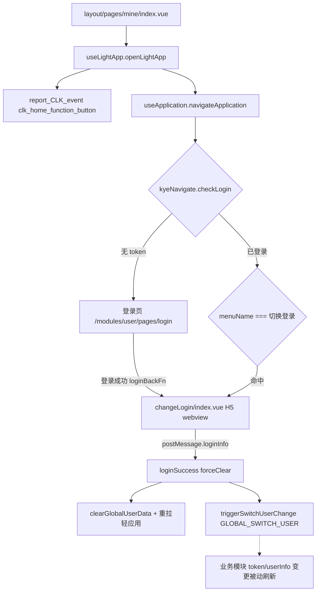
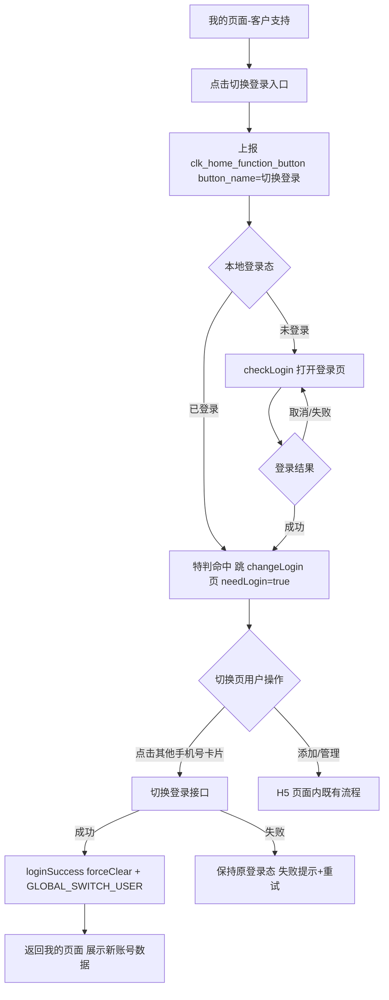

# Design: switch-login-entry

## Context

对应 proposal 能力 `switch-login-entry`：移动端各端【我的】页面客户支持区域新增「切换登录」轻应用入口（禅道 #577091）。设计前提：Taro 4 + Vue3 `<script setup>`；九宫格入口为纯后端轻应用配置驱动；跳转特判、登录拦截、切换登录页（H5 webview）、全局生效机制在仓内均已存在，本次设计以「复用既有链路 + 边界核对」为核心，不新建页面、不新增接口。

## Terminology

- **轻应用入口**：后台配置的九宫格项（`ApplicationItem`：`menuName`/`menuCode`/`areaCode`/`accessMode`/`smallIcon` 等），由 `useLightApp` 按区域编码拉取并渲染
- **客户支持区域**：微信端区域编码 `A6104`（`'我的-常用功能新'`，默认数据 areaName 为「客户支持」），支付宝端 `A5104`
- **切换登录特判**：`src/public/utils/application/useApplication.ts:138-156` 中 `applicationItem.menuName === '切换登录'` 分支，拼 H5 链接后跳 `/modules/user/pages/changeLogin/index?url=...&needLogin=true`
- **切换登录手机号页面**：`src/modules/user/pages/changeLogin/index.vue`，线上使用 H5 webview 版（`CommonWebview` 加载 `change-login-phone.html#/home`），原生版 `index.native.vue` 未启用
- **全局生效**：切换成功后 `loginSuccess(loginInfo, { forceClear: true })`（`clearGlobalUserData` + 重拉轻应用等）+ `triggerSwitchUserChange`（`GLOBAL_SWITCH_USER` 事件，`src/public/storage/storageEvent.ts`）
- **登录拦截**：`kyeNavigate.checkLogin(callback)`（`src/public/utils/native/navigate/index.ts:106`）→ 未登录打开登录页并登记 `loginBackFn`，登录成功后 `loginSuccessBackDefault()` 执行回跳回调

## Goals / Non-Goals

**Goals:**

- 客户支持区域第 16 个入口「切换登录」各端（微信/支付宝小程序）一致展示，命中既有特判直达切换登录手机号页面
- 登录态分流：已登录直达；未登录先登录、成功后自动进入切换页
- 切换成功账号状态全局生效并重拉全量数据；失败保持原登录态
- 埋点 `clk_home_function_button` 自动携带 `button_name = 切换登录`

**Non-Goals:**

- 不改造 APP 原生端（安卓/苹果/鸿蒙，App 团队单独实施）与飞书端（走 H5，不在本仓库）
- 不启用/重构原生版切换登录页 `index.native.vue`，沿用 H5 webview 版
- 不改造切换登录手机号页面内部既有能力（账号上限 3 个、禁止他人切换开关、添加/管理删除，均为 H5 页面内既有逻辑）
- 不改动原有【切换手机号】入口及其链路
- 不新增埋点事件、不新增后端接口
- 不强制各业务模块补监听 `GLOBAL_SWITCH_USER`（沿用 token/userInfo 变更事件被动刷新现状，见决策 5）

## Decisions

### 决策 1：入口供给方式 —— 后台轻应用配置 + 前端既有特判，不本地硬编码

**决策内容**：入口由后台在客户支持区域（weapp `A6104` / alipay `A5104`）配置 `menuName = '切换登录'`、`menuCode = 'M6814'` 的轻应用项；前端复用 `useApplication.ts` 既有 `menuName === '切换登录'` 特判完成跳转，不在本地入口数组中硬编码。
**理由**：我的页面九宫格全量为配置驱动（`useGetAreaLightApp` → `getAreasApplicationAndMarkers`），本地仅兜底默认数据；特判分支已存在且与设置页 `useLoginSwitch.handleChangeLoginH5` 逻辑同源；配置驱动同时提供天然回滚手段（后台下线配置即隐藏入口）。
**备选方案**：本地硬编码第 16 个入口。依据：破坏配置驱动单一事实源，与「跨越招聘」等既有入口模式不一致，且失去后台下线的回滚能力。

### 决策 2：登录态分流 —— 复用 `checkLogin` + `loginBackFn` 统一拦截，不新增守卫

**决策内容**：点击入口走 `useLightApp.openLightApp` → `navigateApplication`，其开头统一执行 `kyeNavigate.checkLogin(cb)`：无 token 时 `openLoginPage()` 打开登录页并登记回跳回调；登录成功后 `loginSuccessBackDefault()` 执行回调以 `redirectTo` 进入切换页。
**理由**：验收标准「未登录→登录页→登录成功自动进入切换页」与该机制行为完全一致；所有轻应用入口同一拦截口径，新增特例守卫会引入第二套登录分流逻辑。
**备选方案**：在特判分支内自行判断 `useLogin().isLogin` 并手动跳登录页。依据：绕过统一拦截会造成登录回跳路径与既有入口不一致，回归面扩大。

### 决策 3：切换登录页 —— 复用 H5 webview 版 `changeLogin/index.vue`

**决策内容**：切换登录手机号页面沿用线上 H5 webview 版（`CommonWebview` 加载 `change-login-phone.html#/home`），页面参数 `needLogin=true` 触发 `autoLoginHook` 兜底；切号成功经 `onMessage` 收 `postMessage.loginInfo` 后 `loginSuccess(..., { forceClear: true })` + `triggerSwitchUserChange`。
**理由**：目录内《切换登录手机号.md》明确"原生未接完、暂使用 H5"；PRD 亦声明页面能力沿用现有模块不做重构。账号卡片、当前登录标识、禁止切换开关、添加/管理等均在 H5 页面内既有实现。
**备选方案**：启用 `index.native.vue` 原生版。依据：原生版未接完（验证码、SSO 切换等链路未完成），启用即引入未完成代码，远超本期范围。

### 决策 4：组件选型与状态管理 —— 无新组件、无新状态

**决策内容**：不新增组件、不新增 Pinia store、不新增路由；登录态读取沿用 `getToken()` / `useLogin()`，切换后状态由 `loginSuccess` 统一写入 `TOKEN`/`USER_INFO` 缓存与 `useUserGlobalStore`。
**理由**：本次为入口级变更，全部状态写入已收口于 `loginSuccess`；引入新状态层无消费方。
**备选方案**：无其他可行方案。

### 决策 5：全局生效的模块刷新 —— 沿用 token/userInfo 变更事件被动刷新，不补 `GLOBAL_SWITCH_USER` 监听

**决策内容**：切换成功后各业务模块（我的、寄件、查件、消息等）的重拉沿用现有 `onTokenChange`/`onUserInfoChange`/`onGlobalDataChange` 被动刷新机制；本期不要求各模块补监听 `GLOBAL_SWITCH_USER`（当前显式监听方仅 `delivery-area` 与 `useCommonHook` 自身）。
**理由**：`loginSuccess({ forceClear: true })` 已先 `clearGlobalUserData()` 再统一写缓存并触发 token/userInfo 变更事件，既有模块在 `useDidShow`/事件回调中重拉数据，行为与设置页既有切换入口一致；PRD「涉及模块清单待研发确认」亦为待确认项，本期不扩大改动面。
**备选方案**：逐一为我的/寄件/查件/消息模块补 `onSwitchUserChange` 监听。依据：涉及模块清单未确认，且各模块已有 token 变更刷新路径，补监听属重复刷新风险而非缺失修复；列入测试验证项（切换后各 tab 数据正确性），如发现具体模块不刷新再定点补监听。

### 决策 6：支付宝未登录过滤核对 —— 确保新入口不被 `filteAlipayNoLoginApp` 误删

**决策内容**：核对 `useLightApp.ts:41-47` 的支付宝未登录过滤名单，确认 `M6814` 不在过滤 menuCode 之列；若被过滤则从名单中排除或调整过滤条件，保证未登录用户可见入口（点击后按决策 2 分流）。
**理由**：PRD 验收标准要求未登录用户可点击入口进入登录页；若入口被未登录过滤直接隐藏，验收不通过。
**备选方案**：接受未登录不展示。依据：与验收标准第 1、3 条冲突，不可行。

### 决策 7：兜底默认数据 —— 暂不补充 esm.js 默认入口，待产品确认

**决策内容**：`src/libs/application/{weapp,alipay}.esm.js` 内嵌兜底数据本期不新增「切换登录」项；接口不可用的极端场景下入口不展示。是否补兜底列入待确认项。
**理由**：兜底数据仅在轻应用接口失败时使用，补兜底意味着断网场景也多一条入口；该取舍属产品口径（PRD 未覆盖断网兜底场景）。
**备选方案**：同步补充兜底默认数据。依据：接口不可用时切换登录接口大概率也不可用，入口展示后点击失败的体验收益存疑，故默认不补。

### 决策 8：表单校验 —— 不涉及

**决策内容**：本能力无前端表单（验证码等校验在 H5 页面内），无校验规则设计。
**备选方案**：无其他可行方案。

## Risks / Trade-offs

| 风险/权衡 | 说明 | 应对 |
| --- | --- | --- |
| 特判依赖 `menuName` 字符串精确匹配 | 后台配置名称若含空格/错别字（如「切换登陆」），特判落空至通用 webview 分支，链路偏离验收 | 配置上线前与后台确认 `menuName` 精确为「切换登录」；测试用例覆盖入口点击实际跳转路径 |
| `GLOBAL_SWITCH_USER` 监听方少 | 业务模块重拉主要依赖 token/userInfo 变更事件，个别模块可能存在切换后旧数据残留 | 列入测试验证清单（切换后我的/寄件/查件/消息数据为新账号）；发现问题模块定点补 `onSwitchUserChange` |
| 切换后 token 失效的初始化冲突 | `src/app.ts:39-43` 已有特判：app 从后台回来若当前页是 changeLogin 则跳过初始化 | 回归该特判在新入口路径下同样生效（路径相同，预期无需改动，测试覆盖） |
| 高德容器差异 | 高德走 alipay 环境（`isAmapMiniApp`），登录授权能力可能受限 | 沿用各端现有登录与授权方案；差异点列入多端回归清单 |
| `isH5FSEnv` 表达式恒真（现状疑似 bug） | `isH5Env && /lark\//i.test(ua) || isH5Env` 恒等于 `isH5Env` | 本需求不引用该变量、不修复（飞书端不在本仓库范围），仅记录在案 |
| 入口排序与容纳 | 客户支持区域第 16 个入口的换行展示规则待 UI 确认（PRD 待确认项） | 九宫格为通用渲染，新增项自动换行；UI 确认后若需调整排序由后台配置完成，无前端改动 |

## Architecture

### 目录结构（本变更涉及文件，均为核对/复用，无新建）

```
src/
├── layout/pages/mine/
│   ├── index.vue                              # 我的页面：渲染 lightApp 区域（复用，不改动）
│   └── hooks/
│       └── useLightApp.ts                     # openLightApp：埋点上报 + navigateApplication；
│                                              #   filteAlipayNoLoginApp 未登录过滤（核对 M6814）
├── public/
│   ├── utils/application/
│   │   ├── useApplication.ts                  # navigateApplication 登录拦截；
│   │   │                                      #   menuName==='切换登录' 特判（既有，核对）
│   │   └── applicationService.ts              # getAreasApplicationAndMarkers 轻应用拉取
│   ├── utils/native/navigate/index.ts         # kyeNavigate.checkLogin / loginBackFn
│   ├── utils/user/useAutoLogin.ts             # autoLoginHook（changeLogin 页 needLogin 兜底）
│   ├── storage/storageEvent.ts                # GLOBAL_SWITCH_USER 事件总线
│   └── utils/reportUtil.ts                    # report_CLK_event('clk_home_function_button')
└── modules/user/pages/changeLogin/
    └── index.vue                              # 切换登录手机号页（H5 webview 版，复用不改动）
```

### 模块依赖关系



### 核心业务流程



### 路由规划

| 路由路径 | 组件 | 参数 | 守卫 | 说明 |
| --- | --- | --- | --- | --- |
| `/modules/user/pages/changeLogin/index` | `changeLogin/index.vue` | `url`（H5 链接）、`needLogin=true` | `autoLoginHook` 页内兜底 | 既有路由（user 分包，`wx.config.ts:30` / `alipay.config.ts:36`），本次无新增 |

### 数据流向

| 方向 | 方式 | 场景 |
| --- | --- | --- |
| 后台 → 页面 | 轻应用接口 + `onApplicationChange` 事件 | 入口列表拉取与配置变更刷新 |
| H5 → 小程序 | `postMessage.loginInfo` → `onMessage` | 切换成功后登录信息回传 |
| 跨模块 | `GLOBAL_SWITCH_USER` / token/userInfo 变更事件 | 切换后业务模块数据刷新 |

## Data Model

### 核心实体

#### ApplicationItem（既有，`src/public/utils/application/applicationType.ts`）

| 字段名 | 类型 | 必填 | 默认值 | 枚举/lookupCode | 示例 |
| --- | --- | --- | --- | --- | --- |
| menuName | `string` | 否 | - | 特判值「切换登录」 | `切换登录` |
| menuCode | `string` | 是 | - | 本入口 `M6814` | `M6814` |
| areaCode | `string` | 否 | - | weapp `A6104` / alipay `A5104` | `A6104` |
| customParam | `string` | 是 | - | JSON 扩展参数 | `{"needBindCode":...}` |
| loadAddress | `string` | 是 | - | H5 域名 | - |
| applicationCode | `string` | 是 | - | - | - |
| accessMode | `0 \| 1 \| 2` | 是 | - | 0-H5 webview、1-内部路由、2-跳小程序 | `0` |
| smallIcon | `string` | 是 | - | 入口图标 | - |

### 状态管理

不新增 store。登录态：`TOKEN`/`USER_INFO` 缓存（`src/public/storage/user.ts`）+ `useUserGlobalStore`；写入统一收口于 `loginSuccess(loginInfo, { forceClear: true })`。

### 通用查询配置

不涉及。

## API Design

不新增接口。复用既有切换登录接口（`src/modules/user/apis/changeLogin/index.ts`）：

| 方法 | 接口编码 | 描述 | 调用方 |
| --- | --- | --- | --- |
| - | `web.login.switch.getSwitchList` | 可切换账号列表 | H5 切换页 |
| - | `web.login.switchLogin` | 切换登录 | H5 切换页 |
| - | `web.login.switch.deleteSwitch` | 删除已添加手机号 | H5 切换页 |
| - | `web.login.switch.setSwitchFlag` | 禁止他人切换开关 | H5 切换页 |
| - | `web.ssoChangeAccount.login` | SSO 切换账号登录 | 设置页既有链路 |

## User Interface Design

页面 UI 均为既有实现，本次无视觉改动：

- 九宫格入口项：`AppItem`（`mine/components/app-item-new/index.vue`）通用渲染，图标/文案取自配置
- 切换登录手机号页：H5 页面既有 UI（账号卡片 3-4-4 分段、当前登录橙色标识、禁止切换开关仅当前卡片、右上角【管理】、底部【+ 添加登录手机号】、上限提示、加载态/空态/错误态）

### 状态说明

| 状态 | 展示方式 |
| --- | --- |
| **Loading** | 切换页列表区加载态（H5 页面内既有） |
| **Empty** | 空态文案「暂无其他登录手机号，可点击添加」+【+ 添加登录手机号】 |
| **Error** | 错误占位 +【重新加载】；切换失败 toast/弹窗提示 + 重试 |

## Security & Performance

### 安全

| 类别 | 措施 | 说明 |
| --- | --- | --- |
| 敏感操作校验 | 目标账号开启「禁止他人切换」时需验证码校验 | 沿用 H5 页面既有规则（SMS_CODE_TYPE 12/13/14） |
| token 安全 | 切换成功后旧 token 失效，`app.ts:39-43` 特判避免失效 token 初始化报错 | 既有机制，回归验证 |

### 性能

| 项 | 说明 |
| --- | --- |
| 包体积 | 无新增页面/组件/依赖，包体积零增长 |
| 首屏 | 入口为配置数据的一项，不增加请求数 |

## 待确认项（PRD 遗留，不影响前端开发启动）

1. 入口排序与客户支持 15 个图标位的换行展示规则（待 UI 确认，后台配置可调）
2. 「全局生效」涉及模块清单（待研发确认，本期沿用被动刷新，测试验证）
3. 「手机号禁止他人切换」校验细则（沿用现有逻辑，细则待确认）
4. 各小程序端登录授权差异（高德/飞书沿用各端现状）
5. esm.js 兜底默认数据是否补「切换登录」项（决策 7）
