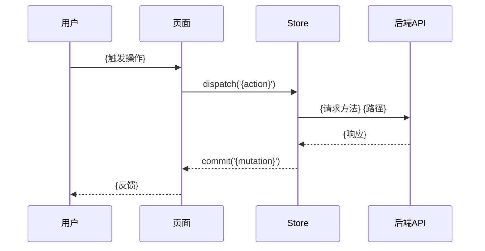

# Design: {设计名称}

---

## Context

<!-- 3句话内交代业务场景和设计前提，明确对应 proposal 中的哪个能力 -->

本设计对应 proposal 中的能力：{kebab-case-capability-name}。

---

## Terminology

### 术语表

| **术语**    | 定义   |
| ----------- | ------ |
| **{术语1}** | {定义} |
| **{术语2}** | {定义} |

---

## Goals / Non-Goals

### Goals

<!-- 聚焦可交付功能，至少 1 条 -->

- {Goal 1}
- {Goal 2}

### Non-Goals

<!-- 明确不做的事，防范围蔓延，至少 1 条 -->

- {Non-Goal 1}
- {Non-Goal 2}

---

## Decisions

<!-- 逐条记录关键设计决策。必须覆盖：组件选型、状态管理、路由、数据获取、表单校验 -->

### 1. {决策标题}

**决策内容**：{具体决策描述}

**理由**：{为什么这样决策}

**备选方案**：

- {备选方案描述及依据，如无则写「无其他可行方案」}

### 2. {决策标题}

**决策内容**：{具体决策描述}

**理由**：{为什么这样决策}

**备选方案**：

- {备选方案描述及依据，如无则写「无其他可行方案」}

---

## Risks / Trade-offs

<!-- 每个设计决策若带来权衡（性能 vs 可维护性等），需明确写出 -->

| 决策       | 风险 / 权衡      | 缓解措施   |
| ---------- | ---------------- | ---------- |
| {决策标题} | {风险或权衡描述} | {缓解措施} |

---

## Architecture

### 目录结构

```
src/
├── views/
│   └── {module}/
│       ├── index.vue              # {页面描述}
│       ├── components/
│       │   └── {Component}.vue    # {组件描述}
│       └── hooks/
│           └── use{Xxx}.ts        # {Hook 描述}
├── api/
│   └── {module}.ts                # {API 模块}
├── store/
│   └── {module}.ts                # {状态管理}
└── router/
    └── {module}.ts                # {路由配置}
```

### 框架层级关系

```mermaid
graph TD
    A[{父组件}] --> B[{子组件1}]
    A --> C[{子组件2}]
    B --> D[{孙子组件}]
```

### 核心业务流程



### 路由规划

| 路由路径  | 组件          | 参数       | 守卫      | 说明   |
| --------- | ------------- | ---------- | --------- | ------ |
| `/{path}` | `{Component}` | `{params}` | `{guard}` | {说明} |

### 数据流向

| 方向    | 方式                     | 场景       |
| ------- | ------------------------ | ---------- |
| 父 → 子 | props                    | {场景描述} |
| 子 → 父 | `$emit` / `defineEmits`  | {场景描述} |
| 跨组件  | Pinia store / Vuex store | {场景描述} |

<!-- 若页面使用通用查询配置（genericCode），须标注编码 -->
<!-- 通用查询编码：{genericCode} -->

---

## Data Model

### 核心实体

#### {实体名称}

| 字段名      | 类型     | 必填    | 默认值    | 枚举/lookupCode | 示例     |
| ----------- | -------- | ------- | --------- | --------------- | -------- |
| {fieldName} | `{type}` | {是/否} | {default} | `{lookupCode}`  | {示例值} |

### 状态管理（Pinia/Vuex）

```typescript
// store/{module}.ts

interface State {
  // {字段}: {类型}  // {描述}
}

const state: State = {
  // ...
};

const getters = {
  // {getterName}(state): {返回类型} - {描述}
};

const actions = {
  // async {actionName}({ commit }, payload): Promise<void> - {描述}
};
```

### 表单定义

| 字段        | 组件类型                    | 校验规则                                         | 说明   |
| ----------- | --------------------------- | ------------------------------------------------ | ------ |
| {fieldName} | `{Input/Select/DatePicker}` | `required` / `maxlength:{n}` / `pattern:{regex}` | {说明} |

### 通用查询配置（如涉及）

| propertyName   | columnName   | columnType   | lookupCode     | 说明   |
| -------------- | ------------ | ------------ | -------------- | ------ |
| {propertyName} | {columnName} | {columnType} | `{lookupCode}` | {说明} |

---

## API Design

### 接口清单

| 方法   | 路径              | 描述   |
| ------ | ----------------- | ------ |
| `GET`  | `/api/{resource}` | {描述} |
| `POST` | `/api/{resource}` | {描述} |

### {API 名称}

**请求参数**：

| 参数名      | 类型     | 必填    | 说明   |
| ----------- | -------- | ------- | ------ |
| {paramName} | `{type}` | {是/否} | {说明} |

**响应结构**：

| 字段名      | 类型     | 说明   |
| ----------- | -------- | ------ |
| {fieldName} | `{type}` | {说明} |

**调用时机**：{何时调用}

**Loading 处理**：{Loading 状态展示方式}

**错误处理**：{错误码 → 处理策略}

---

## User Interface Design

### 页面布局

<!-- 移动端单列布局，组件自上而下排列 -->

```
┌──────────────────────┐
│  {状态栏 / 导航栏}      │
├──────────────────────┤
│  {页面标题}            │
├──────────────────────┤
│  [{操作按钮}]          │
├──────────────────────┤
│  {筛选区 / 表单区}      │
│  {字段1}              │
│  {字段2}              │
│  ...                  │
├──────────────────────┤
│  {内容区}              │
│  ┌──────────────────┐ │
│  │ {卡片 / 列表项}    │ │
│  ├──────────────────┤ │
│  │ {卡片 / 列表项}    │ │
│  └──────────────────┘ │
├──────────────────────┤
│  {滚动加载 / 分页器}    │
├──────────────────────┤
│  {底部导航栏 / TabBar} │
└──────────────────────┘
```

### 状态说明

| 状态        | 展示方式                             |
| ----------- | ------------------------------------ |
| **Loading** | {骨架屏 / 顶部加载条 / 居中 spinner} |
| **Empty**   | {空状态插图 + 文案 + 操作引导按钮}   |
| **Error**   | {错误提示 + 重试按钮 / 网络异常页}   |

### 交互行为

#### 1. {交互名称}

**触发条件**：{用户如何触发（点击 / 长按 / 滑动 / 下拉刷新 / 上拉加载）}

**交互链路**：

```pseudo
1. 用户点击「{按钮}」→ 表单校验 → 校验通过
2. 触发 $emit('{eventName}', payload) 或 调用 API 直接提交
3. 显示 Loading（按钮 loading 状态 / 全局 toast loading）
4. API 返回成功 → Taro.showToast({ title: '{成功文案}', icon: 'success' }) / Toast.success('{成功文案}')
5. 关闭弹窗 / 返回上一页 / 刷新列表
```

**结果**：{预期结果}

### 列表配置

| 属性       | 配置                                    |
| ---------- | --------------------------------------- |
| 加载方式   | 滚动到底自动加载（无限滚动） / 后端分页 |
| 下拉刷新   | 启用 / 不启用                           |
| 默认排序   | {字段} {asc/desc}                       |
| 滑动操作   | {左滑删除 / 左滑编辑 / 无}              |
| 列表项布局 | {单行 / 多行 / 卡片 / 图文混排}         |

---

## Security & Performance

### 安全

| 类别         | 措施                  | 说明   |
| ------------ | --------------------- | ------ |
| 敏感字段脱敏 | {字段名} → {脱敏规则} | {说明} |
| 前端加密     | {加密算法/场景}       | {说明} |

### 权限控制

**页面级权限**：

| 菜单ID   | 路由      | 守卫        |
| -------- | --------- | ----------- |
| {menuId} | `/{path}` | {guardName} |

**按钮级权限**：

| authCode     | 按钮       | 位置        |
| ------------ | ---------- | ----------- |
| `{authCode}` | {按钮名称} | {页面/组件} |

### 性能

| 策略     | 方式                                         | 说明   |
| -------- | -------------------------------------------- | ------ |
| 缓存策略 | {keep-alive / localStorage / sessionStorage} | {说明} |
| 懒加载   | 路由懒加载 / 组件异步加载                    | {说明} |
| 分页方式 | 后端分页                                     | {说明} |

---

## Module Dependencies

### 受影响的模块

| 模块         | 影响范围   | 应对方式   |
| ------------ | ---------- | ---------- |
| {已有模块名} | {影响描述} | {应对方式} |

### 依赖的工具/组件

| 名称   | 类型                      | 版本     | 用途   |
| ------ | ------------------------- | -------- | ------ |
| {名称} | {公共组件/工具方法/npm包} | {版本号} | {用途} |

### 依赖的后端服务

| 接口     | 方法                    | 入参       | 出参       |
| -------- | ----------------------- | ---------- | ---------- |
| `{路径}` | `{GET/POST/PUT/DELETE}` | {入参字段} | {出参字段} |

---

## Compatibility

### 新旧数据兼容

<!-- 页面改版后，历史数据如何展示、如何处理字段缺失 -->
<!-- 不适用则写「不涉及」并说明原因 -->

{描述兼容策略，或写「不涉及」+ 原因}

### 接口版本兼容

<!-- API 变更时前端如何处理新旧接口返回格式差异 -->
<!-- 不适用则写「不涉及」并说明原因 -->

{描述兼容策略，或写「不涉及」+ 原因}

### 路由兼容

<!-- URL 变更后的旧链接重定向策略 -->
<!-- 不适用则写「不涉及」并说明原因 -->

{描述兼容策略，或写「不涉及」+ 原因}

---

## Deliverables

<!-- 无产出写「本次无公共产出」，禁止留空 -->

| 类型              | 名称               | 用途   | 路径         |
| ----------------- | ------------------ | ------ | ------------ |
| 公共组件          | {组件名}           | {用途} | `{文件路径}` |
| 公共方法/工具函数 | {方法名}           | {用途} | `{文件路径}` |
| 公共配置          | {constant/enum/js} | {用途} | `{文件路径}` |
