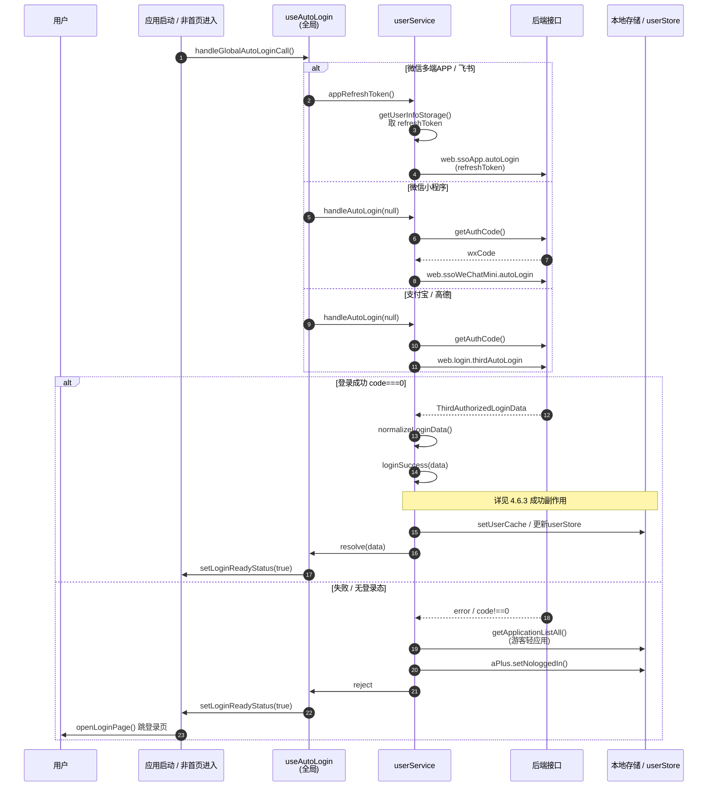
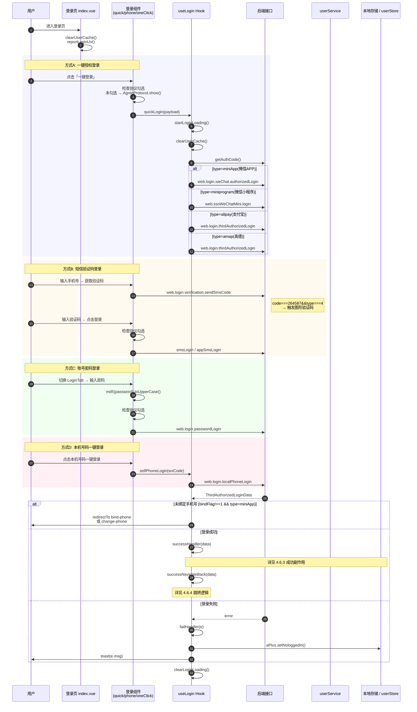
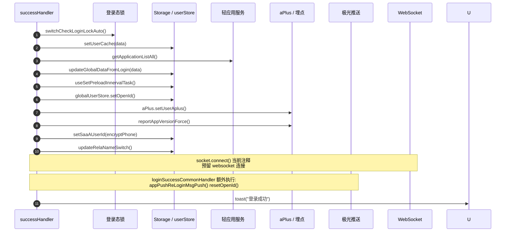
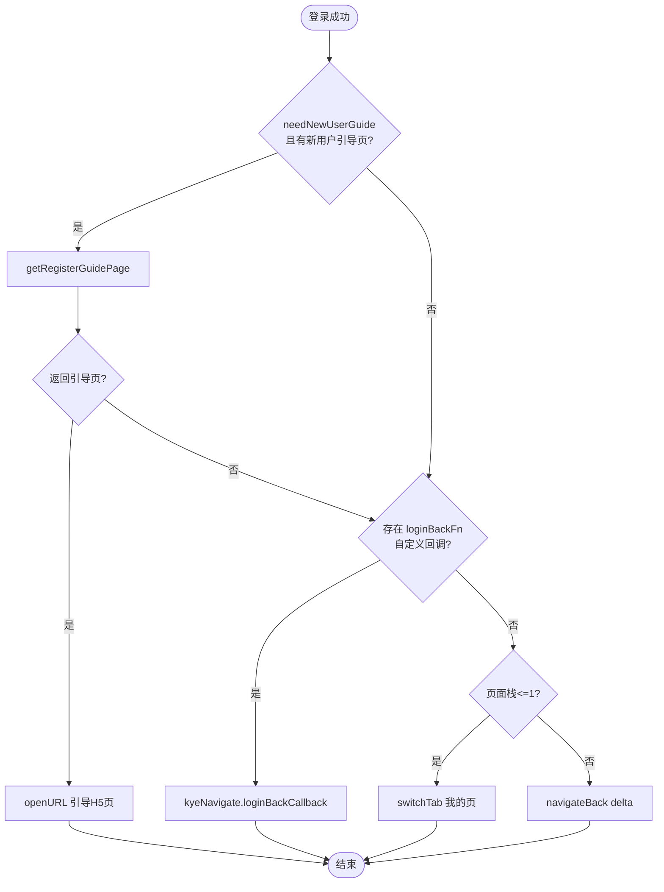
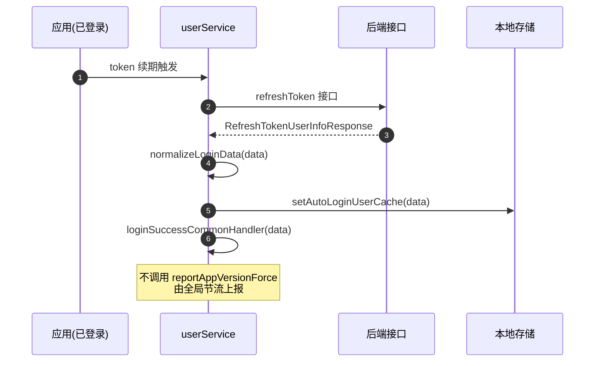

# 用户模块（user）开发文档

> 本文档面向新加入的同学，帮助你快速了解 `src/modules/user` 模块的整体结构、核心功能与关键执行链路（以登录场景为主线）。

## 一、模块概览

`user` 模块是跨越寄件多端小程序的**用户分包**，承担用户身份相关的全部能力，包括：登录/登出、自动登录、实名认证、账号注销、扫码登录/绑码、切换登录手机号、个人信息设置等。

该模块是一个 Taro 分包（`packageName: 'user'`），所有接口请求都经由 `apis/requestUser.ts` 统一封装，挂载 `user` 分包标识。

### 目录结构

```
src/modules/user/
├── apis/                  # 接口定义（按业务域拆分）
│   ├── requestUser.ts     # 分包请求统一封装（httpUser）
│   ├── login/             # 登录相关接口
│   ├── user/              # 用户信息接口
│   ├── realname/          # 实名认证接口
│   ├── changeLogin/       # 切换登录手机号接口
│   └── account-logoff/    # 账号注销接口（按接口拆分多文件）
├── components/            # 模块内复用组件
│   ├── agree-protocol/    # 协议勾选 + 隐私弹窗
│   ├── agreement-popup/   # 协议阅读弹窗
│   ├── code-input/        # 验证码输入框
│   ├── sms-code-popup/    # 短信验证码弹窗（发送/校验）
│   └── index.ts           # 对外导出
├── constants/             # 常量
│   ├── index.ts           # 登录来源 LoginFromType、loginFromType 等
│   ├── scan-login.ts      # 扫码场景/二维码状态枚举
│   ├── cancellation.ts    # 短信验证码类型、注销协议 ID
│   └── commonError.ts     # 通用错误文案
├── pages/                 # 业务页面
│   ├── login/             # 登录页（核心）
│   ├── realname/          # 实名认证
│   ├── user-setting/      # 个人信息设置
│   ├── userEdit/          # 昵称编辑
│   ├── changeLogin/       # 切换登录手机号（H5 webview）
│   ├── bind-phone/        # 微信一键绑定手机号
│   ├── change-phone/      # 验证码绑定手机号
│   ├── scanLogin/         # 扫码登录确认
│   ├── scanBindCode/      # 扫码绑码
│   ├── account-logoff/    # 账号注销
│   ├── account-logoff-feedback/  # 注销反馈
│   └── invite-poster/     # 邀请海报
├── report/                # 埋点上报（login/logout/phone/scanLogin/user）
└── utils/                 # 工具
    ├── device.ts          # 设备型号/系统获取
    ├── index.ts           # 登录错误信息解析、加密
    └── KyeSdk.ts          # 原生方法兼容调用
```

## 二、多端适配说明

模块需适配多端，登录来源（`LoginFromType`）在 `constants/index.ts` 中根据环境动态计算：

| 端          | LoginFromType | 值  |
| ----------- | ------------- | --- |
| 微信小程序   | weapp         | 6   |
| 支付宝小程序 | alipay        | 45  |
| 高德小程序   | amap          | 49  |
| 微信多端 APP | app / ios     | 2   |
| 飞书移动端   | h5_fs         | 51  |
| 飞书 PC 端   | pc_fs         | 53  |

判断端环境的工具来自 `@public/utils`（`isWxMiniApp`、`isAliMiniApp`、`isAmapMiniApp`、`isH5FSEnv`、`isPcFSEnv`）与 `@/public/config`（`isWeixinAppSync`）。新增功能时务必确认各端差异。

## 三、接口层（apis）

### 3.1 分包请求封装

`apis/requestUser.ts` 定义了 `httpUser`，为 user 分包所有接口统一附加 `packageName: 'user'`，并支持请求拦截器：

```ts
export const httpUser = async <T>(apiCode, data, options, packageParams?) => {
  return http(apiCode, data, options, packageParams || packageUserRequestConfig)
}
```

> 注意：实名认证、用户信息等接口使用全局 `http` 而非 `httpUser`（不在分包内），登录相关接口使用 `httpUser`。

### 3.2 主要接口清单

| 业务域       | 文件               | 关键接口（method）                                                                 |
| ------------ | ------------------ | ---------------------------------------------------------------------------------- |
| 登录         | `apis/login/`      | `web.ssoWeChatMini.login`、`web.login.thirdAutoLogin`、`web.login.smsLogin`、`web.login.passwordLogin`、`web.login.logOut` 等 |
| 用户信息     | `apis/user/`       | `web.ssoUser.getUserInfoByPhoneNew`、`web.ssoUser.modifyUserInfo`、`web.user.head.uploadImg`、`web.v2.userRealName.checkAuth` |
| 实名认证     | `apis/realname/`   | `web.v2.userRealName.getAuthDetail`、`web.userRealName.applyPersonAuthV2`、`web.v2.userRealName.applyEnterpriseAuth`、OCR 识别、巴枪扫码校验 |
| 切换登录     | `apis/changeLogin/`| `web.login.switch.getSwitchList`、`web.login.switchLogin`、`web.login.switch.deleteSwitch` |
| 账号注销     | `apis/account-logoff/` | `web.ssoUser.logOff`、`web.login.verification.sendSmsCode`、`web.login.verification.checkSmsCode`、协议列表 |

## 四、登录功能（核心）

登录是本模块最核心、最复杂的链路，涉及多端、多登录方式、自动登录、登录态续期等。

### 4.1 登录页入口

`pages/login/index.vue` 是登录分包页入口，根据端环境在三种登录形态间切换：

- `self`：本机号码一键登录（`phone-one-click`）—— 微信多端 APP / 飞书默认
- `quick`：一键授权登录（`quick-login`）—— 非微信端默认
- `phone`：手机号 + 验证码/密码登录（`phone-login`）

```ts
// pages/login/index.vue
const loginTypeDefault = computed(() => {
  const selectOnePhone = phoneMask?.value?.phoneMask
    ? Taro.getStorageSync('LAST_LOGIN_PAGE_TYPE') || 'self'
    : 'phone'
  if (isH5FSEnv) return selectOnePhone
  return isWeixinAppSync() ? selectOnePhone : 'quick'
})
```

页面加载时执行 `clearUserCache()`（清缓存，PC 飞书除外）并上报 UV；卸载时清理登录成功临时回调 `kyeNavigate.clearLoginBackFn()`。

### 4.2 登录方式详解

#### A. 一键授权登录（quick-login）

`components/quick-login/index.vue`，通过微信 `getPhoneNumber` / 支付宝 `getAuthorize` / 微信 APP `wx.miniapp` / 高德授权获取手机号，调用 `useLogin().quickLogin(payload)`。

`payload.type` 取值：`miniApp`（微信 APP）、`miniprogram`（微信小程序）、`alipay`（支付宝）、`amap`（高德）。

#### B. 手机号验证码/密码登录（phone-login）

`components/phone-login/index.vue`，支持：
- 短信验证码登录：`sendSmsCode` → `smsLogin` / `appSmsLogin`
- 账号密码登录：密码 MD5 加密后调用 `pwdLogin`
- 滑块/图形验证码（Captcha）：接口返回 `code === 264587 && data.type === 4` 时触发
- 记住密码、忘记密码（跳 H5 `/password-manage.html#/forget`）

登录方式通过 `LoginTab` 切换，上次选择记入 `LAST_LOGIN_TYPE`。

#### C. 本机号码一键登录（phone-one-click）

微信多端 APP 场景，调用 `useLogin().selfPhoneLogin(wxCode)` → `appLoginAuthorizedLogin`（`web.login.localPhoneLogin`）。失败时回退掩码提示并切到手机号登录。

### 4.3 核心 Hook：useLogin

`pages/login/hooks/login.ts` 是主动登录的核心，封装了所有主动登录方式的请求与成功/失败处理：

```
quickLogin(payload)
  ├─ ensureWechatInstalled()   # 微信 APP 检测是否安装微信
  ├─ getAuthCode()             # 获取微信 code
  ├─ quickLoginRequest()       # 按 type 分发到对应接口
  │    ├─ miniApp  → wxAppLoginAuthorizedLogin
  │    ├─ alipay   → aliAuthorizedLogin
  │    ├─ amap     → aliAuthorizedLogin
  │    └─ miniprogram → wxAuthorizedLogin
  ├─ 未绑定手机号 → redirectTo bind-phone / change-phone
  └─ 已绑定 → successHandler + successNavigateBack

selfPhoneLogin(wxCode)
  └─ appLoginAuthorizedLogin → successHandler + successNavigateBack
```

**登录成功统一处理 `successHandler`**（`hooks/login.ts:203`）：
1. `switchCheckLoginLockAuto()` —— 登录态锁
2. `setUserCache(data)` —— 写入本地用户缓存
3. `getApplicationListAll()` —— 拉取轻应用列表
4. `updateGlobalDataFromLogin(data)` —— 同步全局 userStore
5. `useSetPreloadInnervalTask()` —— 预载任务
6. `globalUserStore.setOpenId()` —— 写入 openid
7. `aPlus.setUserAplus()` —— APM/埋点用户身份
8. `reportAppVersionForce()` —— APP 版本强制上报
9. `setSaaAUserId()` —— 写入加密手机号
10. `updateRelaNameSwitch()` —— 实名开关配置

**登录成功跳转 `successNavigateBack`**：委托 `loginSuccessBackDefault` 处理新用户引导页、`kyeNavigate.loginBackFn` 自定义回调、默认返回上一页/我的页。

### 4.4 登录服务层：userService

`pages/login/service/userService.ts` 承担更底层的登录能力，被全局（非仅登录页）复用：

| 函数                       | 作用                                                   |
| -------------------------- | ------------------------------------------------------ |
| `authorization`            | 手机号授权登录（支付宝/微信小程序）                    |
| `appAuthorizedLogin`       | 微信 APP 一键登录                                      |
| `handleAutoLogin`          | **自动登录**：getAuthCode → wechatAutoLogin/fetchThirdAutoLogin/appRefreshToken |
| `appRefreshToken`          | APP/飞书 refreshToken 续期                             |
| `loginSuccess`             | 登录成功公共逻辑（写缓存 + loginSuccessCommonHandler） |
| `loginSuccessCommonHandler`| 公共回调（轻应用、埋点、极光重登录、实名开关等）       |
| `loginSuccessBackDefault`  | 登录后默认跳转（新用户引导/自定义回调/返回）           |
| `loggedLoginSuccess`       | 已登录态下的续期成功回调（token 不变，覆写用户信息）   |
| `loggedUpdateUserInfo`     | 续期-更新本地用户信息                                  |

### 4.5 自动登录链路

`pages/login/service/userAutoLoginService.ts` 提供自动登录的触发入口：

```
handleUserLogin(options)        # 非首页进入时判断登录
  └─ handleGlobalAutoLoginCall()  # 全局自动登录 Promise
       └─ 失败 → openLoginPage()  # 跳登录页

handleUserAutoLogin(options)    # 主动调自动登录
  └─ handleAutoLogin(null)
       └─ 失败 → openLoginPage()

handleLoginControl              # 自动登录 + 频次管控（10h 内最多 2 次）
```

应用启动时由全局 `useAutoLogin`（`@public/utils/user/useAutoLogin`）驱动 `handleAutoLogin`，失败则清理埋点、关闭 socket，并标记 `setLoginReadyStatus(true)`。

### 4.6 登录全链路时序图

下图覆盖「自动登录」「主动登录（一键授权 / 短信 / 密码 / 本机号码）」两条主路径，以及登录成功后的副作用与跳转。参与者从左到右依次为：用户、页面/组件、useLogin Hook、userService 服务层、后端接口、本地存储与全局状态。

#### 4.6.1 自动登录（应用启动 / 进入非首页）



#### 4.6.2 主动登录（登录页用户操作）

> 三种登录方式汇入同一个 `successHandler`，仅请求接口不同。



#### 4.6.3 登录成功副作用（successHandler / loginSuccessCommonHandler）



#### 4.6.4 登录成功跳转（loginSuccessBackDefault）



#### 4.6.5 续期登录（已登录态刷新 token）

> 与首次登录的差异：token 不变、走 `setAutoLoginUserCache`、版本上报节流。



### 4.7 登录态数据结构

登录返回的核心类型 `ThirdAuthorizedLoginData`（`apis/login/types.ts`）：

```ts
interface ThirdAuthorizedLoginData {
  phone: string
  ecasToken: EcasToken         // accessToken / refreshToken / 有效期
  customerCode?: string        // 客户编码
  customerName?: string
  openid?: string
  xcxOpenId?: string           // openid 别名
  userId?: string              // 埋点用户 id
  appUserId?: string
  newRegisterFlag?: number     // 新注册标识（驱动新用户引导）
  userStatus?: string
  headUrl?: string
  encryptPhone?: string        // 加密手机号
  // ...
}
```

本地缓存由 `@public/storage` 的 `setUserCache` / `clearUserCache` / `getUserInfoStorage` 管理。

## 五、登出

`pages/login/hooks/useLogout.ts`：

```
onUserLogout()
  ├─ fetchLoginOut('web.login.logOut')
  ├─ clearUserCache()
  ├─ getApplicationListAll()   # 重新拉游客轻应用
  └─ aPlus.setNologgedIn()

onLogOutModal(next, failCall)  # 我的页弹窗确认退登
```

退登后取消极光推送订阅（`appPushLogoutOff`）。

## 六、实名认证（realname）

### 6.1 页面结构

```
pages/realname/
├── home/              # 入口：展示个人/企业认证卡片
├── personal/          # 个人认证表单
├── enterprise/
│   ├── step-one/      # 企业认证第一步
│   └── step-two/      # 企业认证第二步
├── check/             # 认证校验
├── finish/            # 认证完成
├── view-verify-info/  # 查看已认证信息
├── qrcode-error/      # 巴枪扫码异常
├── components/        # 表单、上传、认证卡片等
├── hooks/             # 常量、类型、企业数据、atob、离开拦截
├── store/             # useRealNameStore (pinia + storage 持久化)
└── report/            # 实名埋点
```

### 6.2 执行链路

1. `home/index.vue` 调 `getAuthDetail` 获取个人/企业认证状态
2. 未认证点击卡片 → 跳 `personal` 或 `enterprise/step-one`
3. 企业认证需先绑定客户编码（`checkEnterpriseAuth`）
4. 个人认证：身份证 OCR（`ocrImgByIdentityCard`，支持港澳台/外籍）→ `applyPersonal`
5. 企业认证：校验公司（`checkCompanyName`）→ 营业执照 OCR → `applyEnterprise`
6. 巴枪场景：`realNameQrCodeCheck` 扫码校验 → `confirmQrcodeResult` 确认

### 6.3 状态管理

`store/realName.ts` 使用 Pinia + `Taro.setStorageSync` 双写持久化，存储认证状态、强制认证对象、个人/企业信息等。支持 H5/原生重定向（`redirectToH5`、`relaNameSwitch`）。

## 七、账号注销（account-logoff）

### 7.1 链路

```
account-logoff/index.vue         # 注销确认页
  ├─ 勾选《注销协议》→ AgreementPopup 阅读协议
  ├─ 点击「确定注销」→ SmsCodePopup(captchaType=11)
  │    ├─ sendSmsCode 发送验证码
  │    └─ checkSmsCode 校验
  └─ 校验通过 → navigateTo account-logoff-feedback
```

### 7.2 要点

- 短信验证码类型见 `constants/cancellation.ts` 的 `SMS_CODE_TYPE`（11=注销、12=切换登录、13/14=切换开关）
- 协议 ID、pageCode 区分生产/测试环境
- `apis/account-logoff/index.ts` 采用泛型 `api<K>(code, data)` 封装，按接口拆分类型文件，自带 loading 状态代理

## 八、扫码登录/绑码（scanLogin / scanBindCode）

`pages/scanLogin/index.vue`：PC 客户端扫码后小程序确认登录。

- 解析二维码参数 `q`（`qrCodeToken`、`pageType`、`expireTime`）
- `pageType=10` 登录确认，`pageType=20` 绑码
- `getQRCodeStatus` 查状态 → `operationQrCode`（1扫码/2授权/3取消/7绑定）
- 绑码场景可能渲染 webview 绑定页
- 状态枚举见 `constants/scan-login.ts`（`SCAN_PAGE_TYPE`、`SCAN_CODE_STATUS`）

## 九、切换登录 / 绑定手机号

| 页面           | 场景                                         | 实现                                                                 |
| -------------- | -------------------------------------------- | -------------------------------------------------------------------- |
| `changeLogin`  | 切换登录手机号                               | H5 webview 承载，通过 `postMessage.loginInfo` 回传，调 `loginSuccess(forceClear)` 并 `triggerSwitchUserChange` 全局通知 |
| `bind-phone`   | 微信 APP 一键绑定（已有手机号确认）          | `web.login.weChat.authorizedLoginByRisk` + 图形验证码                |
| `change-phone` | 验证码绑定新手机号                           | 输入手机号 + 短信验证码绑定                                          |

## 十、个人信息设置（user-setting）

`pages/user-setting/index.vue` 展示并编辑：头像（相册选取 + 裁剪 `ImageCropper` + `uploadUserAvatar`）、昵称（跳 `userEdit`）、性别、生日（设置后不可改）、当前绑定公司、公司职务、手机号、注册天数。

- 用户数据来自全局 `useUpdateSomeUserInfoV1` + `useGeneralDataHook`
- 实名认证入口 `openRealNameVerify`（支持 H5/原生重定向）
- 绑定公司/职务经 `useBindCustomer` 跳转轻应用

## 十一、复用组件

| 组件              | 路径                              | 说明                                                                 |
| ----------------- | --------------------------------- | -------------------------------------------------------------------- |
| `AgreeProtocol`   | `components/agree-protocol/`      | 协议勾选 + 隐私弹窗，登录/注销等场景通用；`defineExpose({ show })`   |
| `SmsCodePopup`    | `components/sms-code-popup/`      | 短信验证码弹窗，封装发送/校验/重发倒计时/图形验证码，emit `next`     |
| `AgreementPopup`  | `components/agreement-popup/`     | 协议阅读弹窗（滚动到底才能同意）                                     |
| `CodeInput`       | `components/code-input/`          | 6 位验证码输入框                                                     |

## 十二、埋点（report）

`report/` 按业务域拆分：`login.ts`、`logout.ts`、`phone.ts`、`scanLogin.ts`、`user.ts`，统一基于 `@public/utils/reportUtil` 的 `report_EXP_event` / `report_CLK_event` / `report_other_event` / `report_pv_event`。

登录页关键埋点：
- `reportLoginUv` / `report_EXP_page_logon_login`：页面曝光
- `report_other_login_loginin`：登录结果（login_type、request_result、failure_reason）
- `report_clk_logon_login_other_button`：按钮点击

## 十三、新人快速上手建议

1. **先读登录链路**：从 `pages/login/index.vue` → `components/quick-login` / `phone-login` → `hooks/login.ts` → `service/userService.ts`，理解 `successHandler` 做了哪些副作用。
2. **理解自动登录**：看 `service/userAutoLoginService.ts` 与全局 `@public/utils/user/useAutoLogin`，区分「主动登录」与「自动登录/续期」两条路径。
3. **区分端环境**：改动登录逻辑时，务必确认 `isWxMiniApp` / `isAliMiniApp` / `isWeixinAppSync` / `isH5FSEnv` / `isPcFSEnv` 各分支。
4. **接口归属**：登录接口走 `httpUser`（分包），实名/用户信息走全局 `http`，新增接口注意选对封装。
5. **登录态**：用户缓存读写统一用 `@public/storage`（`setUserCache` / `clearUserCache` / `getUserInfoStorage`），勿直接操作 storage key。
6. **埋点**：新增交互记得补 `report/` 下对应埋点，保持数据上报完整。

## 十四、关键文件索引

| 关注点         | 文件                                                                                 |
| -------------- | ------------------------------------------------------------------------------------ |
| 登录页入口     | `pages/login/index.vue`                                                              |
| 主动登录 Hook  | `pages/login/hooks/login.ts`                                                         |
| 登录服务层     | `pages/login/service/userService.ts`                                                 |
| 自动登录       | `pages/login/service/userAutoLoginService.ts`                                        |
| 登出           | `pages/login/hooks/useLogout.ts`                                                     |
| 登录接口       | `apis/login/index.ts`                                                                |
| 登录类型定义   | `apis/login/types.ts`                                                                |
| 分包请求封装   | `apis/requestUser.ts`                                                                |
| 登录来源常量   | `constants/index.ts`                                                                 |
| 实名认证入口   | `pages/realname/home/index.vue`                                                      |
| 实名认证接口   | `apis/realname/index.ts`                                                             |
| 实名状态管理   | `pages/realname/store/realName.ts`                                                   |
| 账号注销       | `pages/account-logoff/index.vue`、`apis/account-logoff/index.ts`                     |
| 扫码登录       | `pages/scanLogin/index.vue`、`constants/scan-login.ts`                               |
| 个人信息设置   | `pages/user-setting/index.vue`                                                       |
| 设备信息       | `utils/device.ts`                                                                    |
