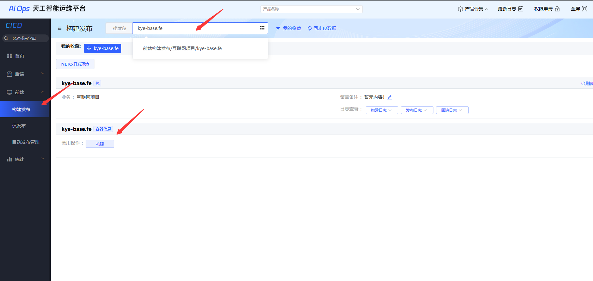

## 本地开发

```bash
# install dependencies
$ pnpm install

# 开发环境调试
$ pnpm dev

# 本地打包
$ pnpm run build

# demo 本地预览调试
$ pnpm run demo

# 查看文档
$ pnpm run doc:dev
```

## NPM包发布

1. 天工平台 https://aiops.ky-tech.com.cn/devops/f/home/cicd#/front/deploy

2. 前端->构建发布->搜索`kye-base.fe`

3. 选择master分支

4. 构建选择`run publish`命令

  


## 文档开发
1. 在对应子包目录创建index.md文件
2. 在*.dumirc*配置，加上对应路由映射即可

## 目录说明
```bash
kye-npm-base
├─ demo                                  本地调试项目工程
├─ docs                                  md文档相关
├─ packages                              服务端代码
    ├─ native                            Native npm包
    ├─ utils                             Utils npm包
└─ .dumirc                               dumi配置文件件
```
